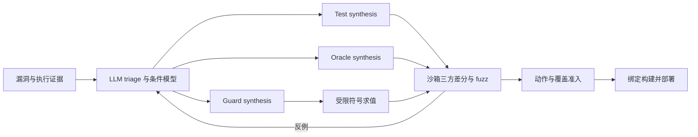

# VulGate：快速缓解的合成、验证与 Frontier 实现（2026-10-14）

本文是 AI 维护的实现说明，保存在 `docs/ai`，没有替代 `docs/human` 的已确认材料。

当前类型阶段快照：原 26 个案例仍输出 55 个返回组合、28 个函数，4 个组合由 confirmed_in_model 降为 partial。两个已人工审查的 nginx 组合中，MP4 暂不列为自动候选，SMTP NULL 保留为 partial。最新 Linux 完整检查为 228 项通过。没有新增真实候选或确认升级；本轮逐项复核了结论变化的源码与原因。源码审查、局部模型支持与实际部署分别记录；当前仍无可自动授权部署的候选。后文保留 56 组合旧基线及各阶段结果，不能与当前结果混用。

## 当前设计目标与范围

面向新披露、可能由 AI 加速发现和利用的漏洞，系统应尽快给出并部署经过验证的临时缓解，同时尽量避免缓解自身引入崩溃、资源异常、错误放行和新的攻击面。目标是缩短“披露到首个有效且通过准入检查的缓解”的时间，不要求漏洞本身必须由 AI 发现，也不把最早生成一段代码当作成功。

本项目采用 SWRR 风格的**只读判定与提前失败返回**。核心贡献按本次设计明确为 **Guard synthesis、Test synthesis、Oracle synthesis**；LLM triage、受限符号求值、sandbox 和 shadow validation 组成反馈流程。Frontier 的安全返回候选发现、动作契约和源码绑定是该流程的支撑机制，不能代替整个研究问题。下文先描述这条主线，再保留分析器的实现和历史验证记录。

“不修改内存”准确指策略不写被保护程序的数据，不修补对象、补引用、释放锁或回滚其内部状态；有界的策略私有存储和沙箱副本可以写入。正常 PASS 后原函数仍可执行自己的写入，失败返回后调用方也可执行既有清理。“不修改原程序”指不生成替换业务逻辑的数据修复补丁；动态 hook 仍改变控制流，某些后端还需改写指令或注册探针，不能宣称字面上完全不改变进程。**提前返回本身改变行为，必须独立验证其失败契约；只读性只约束策略副作用。**

当前主线排除：需要写出复杂结构返回值；失败状态只能通过 out parameter 写回；调用方不接受该失败；返回通道不能表达 failure；以及必须完成被跳过的副作用才能满足协议的边界。仅有指针参数不意味着不适用，关键是失败返回是否仍要求写目标内存。void 回调不能因“不返回数据”自动通过。前一轮讨论的“已入队时返回成功”属于条件成功动作，暂留作扩展研究，不进入本轮 failure-only 自动部署主线。

## Guard、Test、Oracle 合成主线

### 问题定义与输出

输入为漏洞描述 V、PoC P、崩溃/执行轨迹 T、可选官方补丁 D，以及确定的源码/二进制构建、正常测试与必要环境。对于 CopyFail 等可能不崩溃的漏洞，T 可以是写入、信息泄漏或协议事件轨迹，不能强制要求 crash。缺少可复现状态或构建材料要显式记录，不用 LLM 猜测补齐。

输出 runtime sealing policy S 及其证据包：目标构建与作用域、候选边界/失败动作、漏洞条件 K、只读观测及状态生命周期、guard、正负测试、独立 oracle、覆盖目标、验证结果、预算与回退方案。每项生成物都绑定版本和哈希。一个简洁的 guard 文件不构成可部署 S。

在声明的环境 E 和覆盖范围 C 内，要求：恶意执行在目标危险事件发生前被截断；获准正常执行尽量保持原有可观察语义；策略求值不修改目标状态并有资源上界；BLOCK 后满足调用方失败后置条件。策略更新可撤销到上一份有效策略，但不能撤销已拒绝请求或已完成的业务副作用。没有适用动作时输出不适用或未知，不输出一个看似能运行的强制返回。

### 贡献一：Guard synthesis

LLM triage 从 V/P/T/D 提出可检查的漏洞条件，而非只复述 CWE 或匹配 PoC 字节。条件至少包含危险事件、到达路径、参与对象、类型/边界、对象来源或历史依赖，以及未知假设。例如共享页写入的关键是“本次写入是否会触及非私有页”，不能简化成“某个原本就存在缺陷的标志为真”。补丁中的新增条件可以提供线索，但不能把补丁新增的安全行为套到仍未修改的 F_v 上。

生成器把 K 转换为受限 guard：局部表达式、必要的只读语义切片，或有身份与代际的跨点观测。入口缺少的事实只能由已发生且完整记录的事件或经验证的模型取得；不能把未来 I/O、随机结果、并发调度或未知 helper 输出当确定值。返回动作先由 Frontier/契约层筛定，LLM 不能自行写一个 errno、NULL 或成功值绕过筛选。

可检验的贡献是：在明确动作空间内，从异构漏洞证据自动提取条件及依赖、选择可观察边界，并生成有界且可审查的 guard。比较指标包括条件错误率、漏拦、误拦、UNKNOWN、生成到验证的耗时和审查成本。已有的切片、跨过程分析及 LLM 生成不是单独的新颖性结论。

### 贡献二：Test synthesis

测试生成消费漏洞证据和独立条件模型，不只消费生成的 guard。正测试表示应被拦截的执行，至少包括已确认的 PoC/触发轨迹、边界邻域、等价编码和保持触发前提的变体；负测试表示应放行的执行，包括正常测试、相邻但不满足触发条件的输入、合法错误路径及不同调用上下文。未知输入不能因为当前 guard 拦截它就被标为正例。粗粒度 SWRR 有意禁用的合法功能必须作为功能损失单列，不能通过改标签掩盖误拦。

自动扩增针对条件中的每个因子做单独翻转和组合：边界值、整数窄化、别名/来源、事件顺序、递归重入、对象复用、状态丢失、分配/读取失败和预算耗尽。测试应证明自己到达目标路径，避免全部在解析前被拒绝而取得虚假的拦截率。生成无效输入、未命中漏洞、oracle 不确定与发现真实反例分别统计。

测试集分成开发集与冻结的保留集；扩增器的随机种子、重放前缀和环境一起保存。相同模型同时写 guard 和测试容易共享错误，必须引入上游回归、编译执行对照、独立路径目标和非同源变异。函数级 fuzz 的效率有价值，但跨调用问题的测试单位应是“状态建立序列 + 目标调用”，必要时升级为进程/系统/虚拟机重放，不能构造孤立参数假装覆盖生命周期。

### 贡献三：Oracle synthesis

Oracle 应回答“为什么此执行安全或不安全、为什么动作合约满足”，不能仅返回与 guard 相同的布尔表达式。建议生成一份证据关联的 oracle 规范：危险事件及不变量、合法正常行为投影、失败后置条件、路径/时间范围、证据来源和不确定结果。再分别编译成沙箱内的检查脚本、sanitizer/trace 断言、返回与输出比较器、资源及进度检查。LLM 生成规范和脚本候选，可信后端验证其可执行性与来源，不能由候选脚本自授正确性。

语义依据优先来自漏洞父版本的实际操作、官方补丁/回归测试、协议或 API 契约以及独立执行观测。补丁也可能只修一条路径，多个补丁/配置的适用性要分别检查。至少应证明 oracle 对已知错误执行会报错，对受控正常执行不会报错，并能识别人为注入的错误 guard；没有可独立确认的 oracle 时，测试全绿不能成为部署依据。独立模型或另一 LLM 有助于降低相关性，但不能单独充当独立真值。

覆盖目标不仅是 crash stack 的函数名，还包括危险指令/安全不变量、到达它的调用边和前序事件；崩溃栈是已见路径的种子，不是全路径证明。CopyFail 的 oracle 应检查受保护页被非法修改这一安全性质，不能只看函数最终是否返回错误或进程是否存活。运行时监控脚本属于辅助遥测，不能代替部署前 oracle，也不能在危险写入发生后才决定本次是否放行。

### 从生成到准入的闭环



该图描述设计流程。当前 demo 没有完整实现 LLM triage、自动 test/oracle 合成及其闭环；已有 Frontier、scalar monitor 编译和有限 C VM 对照是部分基础。

### 三方差分：哪些等价、哪些只要求安全

令 F_v 为漏洞版本、F_p 为补丁版本、F_g 为漏洞版本加 guard。每次执行从可重放的等价初态开始，固定可控的随机、时钟和外部输入；并发问题还要明确调度范围。不能依次在同一个已变更对象上调用三者。

| 执行区域 | 应验证的关系 | 不成立的推论 |
| --- | --- | --- |
| 已确认良性、语义未被补丁改变的输入 | F_g 与 F_v 的返回、输出及相关可观察状态一致；F_p 作为额外参照 | 不能要求不同版本的裸指针、分配地址、padding 或整个操作系统内存逐字节相同。 |
| 触发漏洞且 guard 阻断 | F_g 不到达目标危险事件，返回值与失败契约一致；调用方资源/协议/进度仍有效 | F_p 可能成功处理，而 F_g 合法拒绝，二者不必同返回值、同输出或同全部内存状态。F_v 发生 UB 后也不是等价性参照。 |
| guard 放行的测试 | 独立 oracle 未发现目标危险事件，覆盖所声明路径；另检查行为保持 | 测试内未发现危险不等于所有输入上 PASS 可靠。 |
| UNKNOWN/ERROR | 使用已获准的安全失败动作，或不准装载该策略 | 缺失事实不能自动降为 False/PASS。 |

“完整内存状态等价”可以作为**受控、确定性、有限堆模型内**的严格实验：保留完整的已建模对象图，归一化分配身份/地址，并比较可定义的字节与别名关系。必须报告未建模区域；不能把局部快照覆盖解释为全进程/内核证明。guard 求值前后目标状态不变是另一项独立检查；它不要求被允许执行的原函数也不写内存。

返回值相同仍可能遗漏进度或输出义务，例如旧 nginx capture 回调原地返回导致解释器不前进；没有 crash 也可能已污染共享页。因此差分记录应包括返回、输出、相关内存/别名、资源所有权、调用方后续执行，以及终止/重试/异步完成情况。

### 受限符号求值与真实执行的分工

这里的 symbolic evaluation 只对选定条件、切片和摘要求解，避免宣称已对整个程序做完整符号执行。使用真实 C 类型、位宽、符号扩展、溢出/UB 规则及别名假设；未知 helper 用有依据的关系或保守未知表示，不当作任意常量 stub。

在已绑定模型内，求解 `路径前提 ∧ guard_PASS ∧ 危险条件` 以寻找漏拦；求解 `已确认良性 ∧ guard_BLOCK` 以寻找误拦；还应单独寻找“动作触发但失败后置条件不成立”。SAT 给出的是待真实重放的反例候选。UNSAT 只排除本次模型与范围中的反例；模型遗漏、超时和路径预算耗尽都不能获得全程序证明。

函数级 fuzz 在真实 F_v/F_p/F_g 中验证候选和继续扩增，sanitizer/trace/oracle 检查真实行为。出现符号结果与真实执行不一致，应修正语义模型或 harness。缺少补丁 D 时，F_p 不得用同一 LLM 猜出的“正确函数”冒充；可以继续两方执行与独立不变量检查，但需降低证据级别，尚缺关键 oracle 时不准部署。并非所有案件都具备三方比较的条件。

### Sandbox 与 shadow execution 的明确边界

离线验证可以运行真实目标代码，在可销毁的进程/虚拟机内建立状态和模拟受控外部服务；不将未知 PoC 放入生产执行。在线 shadow 只执行已支持的只读投影，写入私有影子存储，不能调用真实 spin_lock、kmalloc、文件/网络 I/O 或任意目标 helper 来“提前跑一次”。策略自身的有界私有分配另有预算。

把 `func1()+func2()` 抽出只在两个调用的输入、读写关系、结果关联和顺序可建模时有效。把目标函数全部换成返回常量的 stub，可能恰好抹掉触发条件；模型摘要要有来源和真实对照。未知副作用、不能快照的共享对象和取决于未来 I/O 的结果，按 UNKNOWN 处理。COW 副本隔离内存写入，也不会自动隔离文件、共享映射、设备、锁及外部事务。

Intel MPK 可约束特定访问权限，Arm MTE 提供带标签的内存错误检测；二者都不证明漏洞条件正确、提前返回安全或完整语义等价，也不能相互视为同一种隔离保证。当前主线的可信边界应是明确的 VM 指令集、内存能力、预算、helper 白名单和动作绑定；硬件能力是可选防御层，不能替代这些检查。

### 为速度设计，但不跳过安全准入

预先准备可部署 runtime、类型/ABI 导入器、常见错误契约、可信 oracle 模板和隔离测试镜像。新漏洞到来后，缓存可复用证据，并行生成 guard、测试和 oracle；优先尝试材料完整、动作已知的最小边界。若安全粗粒度 SWRR 先通过同一准入要求，可先提供它并明确功能损失，再用验证通过的精细 guard 恢复功能。没有安全返回动作时，紧急性不能成为发明动作的理由。

准入至少要求：构建/位置/ABI 绑定；无目标写入及预算检查；A/P/C 与观测前提有相应证据；独立 oracle 有效；正负与扩增测试通过且实际到达目标；失败注入和调用方继续执行检查通过；完整证据包与实际装载器强制绑定。测试是必要门槛，不是“无额外威胁”的充分证明。证据强度应区分源码支持、模型内证明、测试覆盖和运行中验证，不用一个 `verified=true` 抹平差别。

部署采用明确版本的策略，旧有效策略执行、新策略 shadow 验证，更新需原子切换并处理在途调用与私有状态代际；撤回新策略回到上一有效策略。若没有有效回退，关闭策略可能重新暴露漏洞，不能描述成无风险回滚。记录披露/材料就绪、首个候选、验证完成、实际启用的分段耗时，同时报告正常功能损失、UNKNOWN、测试覆盖和新增故障；不预设必然快于 Talos in-place。

## 相关工作对照与需要收紧的主张

本次已阅读用户提供的 [KINTSUGI 原文](https://www.usenix.org/system/files/usenixsecurity26-peng-yihao.pdf) 的摘要、威胁模型、系统设计、验证流程、限制及实现附录，并核对相关图表。它不是仅面向 PHP：论文评估 27 个 PHP、Python、Java CVE；运行时后端依赖 Linux eBPF/cgroups。其输入包含捕获的恶意请求和正常执行基线，利用 syscall 差异定位，LLM 划定代码边界，正常轨迹确定白名单，通过隔离 staging 内的攻击/正常请求重放后部署。§4.3.3 已明确包含安全与兼容性双向验证；附录也说明合成工作负载和自动测试来源。因此“LLM + runtime policy + sandbox + tests”本身不足以区分本项目。

KINTSUGI 的核心前提是恶意行为产生可观察的 syscall 偏离，主要约束 OS 层操作能力；源码中加入策略 begin/end 标记，不重写被包围的业务逻辑。VulGate 的目标是在可安全失败的边界识别漏洞语义条件，包括可能没有 syscall 异常的内存破坏/状态问题。值得研究的区别是**由漏洞条件和独立 oracle 驱动的 guard/测试联合合成、部分表达式求解与真实执行反例反馈，以及已验证失败动作的绑定**。这些仍需实现和共同实验，不能从目标不同直接推出速度、准确率或适用范围更优。

| 工作 | 可采用的准确描述与证据状态 | 对本项目的约束 |
| --- | --- | --- |
| Talos / SWRR | [作者项目](https://github.com/huang-zhen/Talos)明确自动生成/插入简单 SWRR，并复用既有错误处理；包含 in-place 与 patch-based 两种部署。不是纯人工写策略。 | 提前返回会改变控制流和功能；“自动”“复用错误返回”“快速启用”不是独占贡献。比较 first mitigation latency 时必须包含其预部署启用模式。 |
| VulShield | [官方论文页](https://www.ndss-symposium.org/ndss-paper/vulshield-protecting-vulnerable-code-before-deploying-patches/)已定位；此前原文摘录记录约束表达式、入口/返回点、既有错误块及 QS/DEC。此次全文下载受限，不新增未经原文核对的细节。 | 不能简化成“只能入口”“只能看单函数”“靠 kill”或“地址探针不能观察复杂状态”。应比较具体表达/状态模型、可选退出位置及其安全义务。 |
| PET | [USENIX 2023 官方摘要](https://www.usenix.org/conference/usenixsecurity23/presentation/wang-zicheng)确认 sanitizer 报告、运行时触发条件和临时防御动作。现有材料中的 checkpoint/restore 细节保留为需完整原文逐项复核的比较项。 | 涉及资源恢复的机制不能写成“只返回、不改变行为”；若比较审核面或新故障风险，应测量具体恢复动作，而非推断别人策略难以人工审查。 |
| KINTSUGI | 本次核对全文相关章节：syscall 差异、LLM 语义边界、profile 白名单、隔离验证和 request-scoped enforcement。 | 与本项目的生成/验证/临时缓解目标重叠。区别应落在条件、oracle 与动作语义，不声称它仅支持 PHP、没有自动验证或不会合成测试负载。 |
| 本文草稿的 InstraGuard 与其它缩写条目 | 尚未确认确切论文题名/版本；`ccs25-stackpatch`、`osdi23-ub`、`ppopp26-ub`、`Beyond Crash-to-Patch` 先保留为待读索引。 | 在补齐引用前不填充“kill、平台、形式化保证”等确定能力结论，避免不同系统或同名工作混淆。 |
| VulGate 当前 demo | 部分返回候选分析、源绑定、受限 scalar monitor 和测试基础可运行；完整合成/独立 oracle/生产准入仍未实现。 | 不写成已具备“形式化保证完整语义一致”或“跨平台生产防御”。Linux 与用户态材料、Windows 上通过部分分析测试均不等于所有平台均已部署验证。 |

对“策略难以审计”的可检验假设是：在相同防护范围下，本方法能否提供更小、证据可追踪的审核对象，减少人工定位错误的时间。必须把隐含在 parser、adapter、状态表、oracle 和 helper 中的代码一起算入审核面；前端 DSL 少几行不是复杂度消失。对“难以通用”，区分论文已实现平台、机制的可迁移性与实际移植成本，不以 Linux 原型直接证明方法只能用于 Linux。

## 100 个漏洞中的复杂状态证据

本节依据旧 Cursor 会话使用的 `results/latest_100_final.csv`（核对为 100 条、按该文件 rank 编号）及 `_harmless_return_meta.json` 作全量元数据筛选，再对下表 9 个 CVE 的相关补丁/源码作定向核对。它不是 100 例全部重做动态验证，也不等于当前 26 例 Frontier 回归集合。旧 `HAS/CONDITIONAL/NO` 混合了安全、选择性和功能损失判断，不能作为现在的部署资格或总体准确率。

对“仅考虑一个函数的状态，难以检测复杂漏洞”的建议表述是：**只依赖危险点当前局部值或现有标志的 guard，可能缺少由前序调用、跨函数对象传递和生命周期形成的关键事实。VulGate 尝试从证据中识别这些依赖，选择额外只读观测或受限语义切片，同时验证其动作与状态一致性。** 不宜把它写成“所有现有系统只看一个函数”，也不能把所有跨函数漏洞都说成必须使用多点 Observer。

| 清单编号与漏洞 | 已核实的状态关系与证据 | 能支持的设计主张 | 当前防御结论 |
| --- | --- | --- | --- |
| #16 CVE-2026-46300；#17 CVE-2026-43503 | #16 补丁在 `skb_try_coalesce` 转移 frags 时传播 `SKBFL_SHARED_FRAG`；#17 补齐 `__pskb_copy_fclone`、`skb_shift`、GRO、segment、TCP payload clone 的传播。页的共享关系保留，目的 skb 的标志却可能丢失，后续 ESP writer 据错误标志跳过 COW。[E1][E2] | **最强的来源传播证据。** 只在最终 writer 检查该标志会漏掉“共享但未标记”的对象；需要可靠来源/别名事实或更早的观测与传播。完整状态快照是否足以重建来源需另证。 | 不能通过 guard 替原程序补标志；可研究私有 provenance 及提前失败，但全部传播边、对象代际、失败动作尚未闭合。未认证为可部署。 |
| #28 CVE-2026-43284 | `__ip_append_data/__ip6_append_data` 接入共享 pipe 页时未标记；`esp_input/esp6_input` 又缺共享页条件。补丁同时修产生端与消费端；不改变 ESP output。[E3] | 单个危险点上的长度/标志判断不足以覆盖完整数据链；测试应同时覆盖共享/私有页及 IPv4/IPv6 路径。 | 粗拒绝 ESP 及精细来源 guard 均需调用方与包所有权契约；不因有负返回就批准。 |
| #32 CVE-2026-31431，CopyFail | 官方修复在 `algif_aead` 恢复 out-of-place，改变 TX/RX scatterlist 构造，移除带 offset 的 count/pull 逻辑，调整 `aead_request_set_crypt` 的 source；涉及 4 个文件。[E4] | 支持“真实条件涉及共享页、scatterlist 来源/别名与加解密路径，不能机械复制一个长度 if”。它是复杂对象图/跨过程语义样例；仅凭补丁不能证明必须记录历史或任意入口快照都不够。 | 尚无经完整审查的细粒度纯返回方案。旧 NO 主要包含“整函数拒绝不够选择性”的判断，不是任何失败入口都不安全的证明；安全粗拒绝可另查，但本轮不新增候选。 |
| #1 CVE-2026-60005 | regex capture 缓冲重新分配后未匹配，旧 `ncaptures` 与新缓冲不一致；后续 length/copy 回调消费该组合。官方在重分配时清计数。[E5] | 支持跨调用的“分配代际—有效结果—后续消费”关系；简单的 miss 标志既可能过宽，也可能遗漏其他失效路径。 | 前轮已核实 capture 回调入口直接 return 会漏推进 `e->ip`；该例可证明观测需求，不能作为已安全返回的成功例。 |
| #50 CVE-2025-53859 | 无认证 MAIL 流程会沿用先前认证尝试留下的 login/passwd；后续 auth HTTP 构造使用它们。补丁在 SMTP handler 清字段，并约束 Auth-Salt 的发送条件。[E6] | 支持会话状态与跨命令/跨函数消费的测试；可能由更完整的当前 session 快照或私有历史补证，不武断声称只能多点记录。 | 已审查的 auth request 构造函数入口 NULL 有源码依据，但机器仍 partial；精细判定与真实部署未完成。入口返回 NGX_OK 不清字段不是修复。 |
| #2 CVE-2026-56434 | 两个路径把同一 subrequest 重复 post，后续 finalize 重复减计数；补丁先查 posted list，已在队列便返回 NGX_OK。[E7] | **对照例：历史已经体现在当前队列中。** 虽是跨调用根因，一个有界且一致的入口队列检查可能已足够，未必需要额外历史状态。 | 条件成功动作超出本轮 failure-only 主线；也不能用它声称所有未知状态都可安全返回成功。 |
| #55 CVE-2025-37899 | session logoff 释放的 `sess->user` 仍可能被另一连接的 `smb2_sess_setup` 使用；已核对 CVE 描述及 logoff 删除提前 free 的补丁片段。[E8] | 支持跨线程生命周期需求，也构成本方案的能力边界：入口快照和私有历史不能自动阻止检查后的并发变化。 | 不声称只读 guard 已解决竞态；必须有一致性证明或另找安全粗拒绝边界。 |
| #72 CVE-2024-1086 | `nft_verdict_init` 接受的 drop error 会由后续 hook 路径消费；前文已审查该初始化入口及调用方失败处理。 | **对照例：跨函数后果可以来自简单局部输入条件。** 不应因为涉及多个函数就归为多点状态问题。 | 保留原候选与 partial 结论；不据本节提升确认等级。 |

来源补丁：

- [E1：coalescing 标志传播](https://github.com/torvalds/linux/commit/f84eca5817390257cef78013d0112481c503b4a3)。
- [E2：frag-transfer helpers 标志传播](https://github.com/torvalds/linux/commit/ff375cc75f9167168db38e0464a482d5fbc8d81d)。该 stable 提交注明 upstream `48f6a5356a33dd78e7144ae1faef95ffc990aae0`，不同版本的 helper 集合不能混用。
- [E3：共享 skb frags 与 ESP 输入](https://github.com/torvalds/linux/commit/b54edf1e9a3fd3491bdcb82a21f8d21315271e0d)，upstream `f4c50a4034e62ab75f1d5cdd191dd5f9c77fdff4`。
- [E4：CopyFail 的 out-of-place 修复](https://github.com/torvalds/linux/commit/a664bf3d603dc3bdcf9ae47cc21e0daec706d7a5)。以上四份本次重新取得完整补丁并保存 SHA-256；确认的是具体状态变化，没有执行漏洞利用。
- [E5：nginx capture 状态修复](https://github.com/nginx/nginx/commit/0cca8e055a2d909f1a00c2071665b502ec2fe94c)，结合前轮保存的父版本脚本解释器源码。
- [E6：nginx stale auth credentials 修复](https://github.com/nginx/nginx/commit/9c02c84a7443f3d736a1a5eb3f596de9af8a0c9c)，本次复读官方补丁和此前绑定父版本的请求构造代码；相关 auth 解码修复仍按前文分别记录。
- [E7：nginx duplicate post 修复](https://github.com/nginx/nginx/commit/700dc9e0e750e3f63587f9d0f9f36bae5ec47202)。
- [E8：ksmbd session logoff 生命周期修复](https://github.com/torvalds/linux/commit/2fc9feff45d92a92cd5f96487655d5be23fb7e2b)，本地缓存为 logoff 的摘录，不能据此声称整个补丁均已动态验证。

这些案例足以支撑研究动机，不能直接证明比 VulShield/PET 覆盖更多。需要固定同一漏洞版本与输入，比较：仅局部 guard、扩大当前只读快照、加入必要历史观测三种方案，在同一动作安全要求下的漏拦、误拦、未知率与代价。若存在两种执行状态在读集 O 上相同、危险性质 K 却不同，任何只依赖 O 的 guard 都不能同时精确区分二者；它仍可保守地拒绝两者并损失功能。生成这类“相同观测、不同安全结果”的成对测试，是 Test/Oracle synthesis 很具体的研究目标。

对 #16/#17/#28，后续测试必须建立共享/私有页的来源并重放复制、转移、合并和消费；仅 fuzz `esp_input` 的几个标量不能覆盖标志丢失。对 #1/#50，测试应携带完整请求/会话前缀与代际；对 #55，测试还需要受控并发调度。它们要求“函数级 fuzz + 状态建立 harness”，必要时增加系统级重放，不能只做孤立纯函数的三方对照。

## 当前 demo 的位置能力：尚不搜索中间返回点

**当前输出、动作绑定与用户态 hook 都是函数入口返回。** 以下四种概念必须分开：

| 能力 | 当前状态与代码证据 |
| --- | --- |
| 找函数内部原有的 return 表达式及位置 | 有。`tools/frontier/parse.py::_return_sites` 扫描函数体；报告的 `return_location/offset/before_acquire` 是返回值来源信息，不是部署位置。 |
| 在漏洞函数、上层调用函数或相关 init 的入口尝试该返回值 | 有。`tools/frontier/analyze.py::_candidates/_values` 搜索这些函数，并固定输出 `position="entry"`。完整安全性仍受前文缺口限制。 |
| 在函数中间观测 | DSL 可保存 `at/after` 文字，但没有实现精确 CFG/机器位置绑定；前轮已复现 lowerer 忽略定位的缺口。不能称为已支持。 |
| 自动找中间位置并让当前函数从那里直接返回 | 没有。`tools/policy/actions.py::bind_actions` 只绑定 `function_entry`/`entry`；`runtime/user/hook.c::hook_entry` 在调用原函数之前决定是否 return。CFG 和调用点返回注入仅用于分析调用方后续行为，不是中间 hook 能力。 |

“外层已经执行到中间，但拦它即将调用的子函数入口”仍属于入口 SWRR。例如外层先持锁/分配，再调用可失败的 child，child 返回错误后外层走原有 `goto cleanup`；被拦的是 child 入口，策略不直接从持锁的外层函数返回。当前分析器可在选中的漏洞函数/祖先入口中表达这种情况，但不会任意自动切出一个新 child，也不会把没有失败契约的 memcpy/strcpy 当作可安全失败的 child。

未来若增加真正的中间直接返回，需要将候选从 `(function, entry, value)` 扩为 `(build, function, CFG位置, 到达状态域, value)`，逐路径证明：此前副作用可被允许保留；没有因跳过后缀而遗漏的锁、引用、资源、输出和进度义务；调用方可接受这个部分执行状态；位置与栈/寄存器恢复符合 ABI；而且仍在危险事件之前。无待释放资源只是其中一项，不是充分条件。

用户示例若已经 `spin_lock()` 和 `kmalloc()`，直接从危险写入前 return 通常会漏 unlock/free，不能按当前机制批准。策略主动补 unlock/free、checkpoint-restore，或跳转至同函数任意错误块属于不同的动作范围，不以“也是提前退出”混入纯返回方案。优先检查上层/子函数入口；只有确有状态与 ABI 证据时才考虑新增中间点搜索。本轮仅记录设计，没有新增中间返回实现。

## 判定对象

一个候选是 `(源码版本, 函数入口, 返回表达式, 调用方集合, 覆盖范围)`，不能只用 `(函数名, errno)` 表示。入口执行 `return -EINVAL` 的行为，必须与调用方可以接受的既有失败契约兼容。原函数中部有 `return -EINVAL` 只提供了返回值来源，不能证明入口可直接返回。

检查分为四个独立问题：

1. **可执行性**：入口处表达式是否可求值，ABI 是否匹配。局部 `PTR_ERR(ctx.link)` 依赖尚未执行的函数体，不能直接用于入口。
2. **返回契约**：每条已知调用边是否处理该失败值；同值重试、回退处理、未检查解引用与成功路径应区别对待。
3. **资源与状态**：入口前属于调用方的资源是否回收；跳过函数体是否遗漏调用方依赖的初始化、锁变化、引用转移、输出参数或清理。
4. **覆盖性**：选择的入口集合是否截断所有相关危险路径。一个上层节点的某个祖先可拦，不代表它的其他祖先分支也被拦。

合法功能被一起拒绝可以接受，但通用读写、系统调用分发等全系统路径仍拒绝作为整函数禁用点。创建期候选在“只保护安装后创建的对象”范围内有意义；还必须确认该 init 在对象注册/启用之前必经，且错误清理能接受完全未执行的 init。不得因为发现 ops 的 `.init` 就直接宣布覆盖。

## 当前实现

`parse.py` 记录函数定义、返回来源及条件编译合并片段的位置；`macros.py` 处理有限的内核语法包装；`calls.py` 建立同文件 static 符号、直接调用、已知结构体 ops 与创建关联；`analyze.py` 枚举自身、有限深度直接祖先和相关 init 的返回值。`resources.py` 只建模小范围的资源身份、直接 owner 字段及清理调用。

本轮修复了入口不可求值的返回表达式、ERR_PTR 内的重试码、-ENOIOCTLCMD 分类顺序、已覆盖赋值误当成返回来源、不同对象的清理混淆、部分分支释放、清理 helper 实参绑定、else 分支重赋值干扰、部分调用方证据丢失、分叉覆盖的 any/all 混淆、跨文件 static 错误解析、常量 #elif 分支、宏改写后行号漂移，以及 init/destroy 的已知初始化依赖。

### HFSC 反例

漏洞父版本 `67af4ec948e8` 中：

`hfsc_init_qdisc` 先执行 `qdisc_watchdog_init`，再因参数错误返回 `-EINVAL`。`qdisc_create` 在 init 返回失败后仍调用 `hfsc_destroy_qdisc`。该 destructor 调用 `qdisc_watchdog_cancel` → `hrtimer_cancel` → `hrtimer_try_to_cancel` → `hrtimer_active`；后者直接读取 `timer->base` 及其 `seq`。

把 `-EINVAL` 搬到入口会跳过 timer 初始化。既有错误返回本身为真，**入口安全性不成立**。本轮将其排除，并加入合成反例测试。当前构造器检查是有限的 helper 配对模型，不能替代所有 init/destroy 的数据依赖分析。

## 给 DSL 生成器的交付契约

模型应读取 schema 2 候选列表及其证据，在人工/后端确认的组合中选择 `candidate_id`，再写拦截条件。保留来源哈希、入口、失败值、覆盖范围和部署前提；模型不能自行替换返回码，也不能将 `partial` 或未知配置升级为安全。

多个返回值属于同一入口时通常只需选择一个；多个入口属于替代方案时不能把所有候选当成安装清单。逐候选覆盖字段有助于识别这一差别。策略编译器现已消费候选 ID 并重放源码绑定；内核模块尚未消费这份绑定，因此仍未完成候选到 ENFORCE 的自动绑定，也没有更改内核默认返回码。

## 为什么仍需真正的静态分析

本轮保留轻量发现后端以便在不完整源码上快速试验，但正则和有限的语句扫描无法证明：跨路径 reaching definitions、返回前的全部副作用、函数指针所有可能目标、引用计数、输出参数有效性、锁顺序、RAII 宏、并发条件或整内核调用图。

下一层应使用实际内核版本、架构、Kconfig 和 compile_commands/build commands：

1. Clang 预处理和 AST 保留宏展开与原始源码映射，不把互斥配置拼成一个程序。
2. CFG/SSA 推导返回值的 reaching definitions、每种候选值的调用方分支以及支配/后支配关系。
3. 对 ops 注册与解引用先做字段敏感目标解析；仍有不确定的调用再交给 LLVM/SVF points-to 分析。SVF 能补目标和别名信息，不能自动证明安全清理。
4. 为资源、输出参数与 init/destroy 构建显式契约；未建模的引用转移、锁状态及对象字段保留 unknown。
5. 在实际父版本内核测试环境中做入口故障注入，检查 PoC 到达性、正常负载、泄漏、锁、崩溃及重试。源码审查、回归测试和动态证据分别记录。

当前 `analysis.enforceable=false` 是能力标记。它不会因为启发式给出 `found` 或测试全绿而改变。

## 验证方法

合成测试必须覆盖错误反例，而不只是成功样例。真实样例使用原会话的 20+6 个 CVE 父版本源码，补充相同版本的结构体头文件。每个输出候选逐项阅读入口、返回来源及调用方处理，并独立记录源码支持、额外前提或拒绝原因。

`tools.frontier.benchmark` 以 SHA-256 绑定材料，逐项比较审查过的候选集合；新增候选不能悄悄算通过。结果只表示这份固定 corpus 的回归一致性。未知的真实候选总数没有穷尽，所以不能据此宣称整体召回率；也不能再用原文档的“18/20 一致”作为安全准确率。

已知缺口包括 `fuse_readdir` 的调用方会根据 callback 输出字段改写最终结果，当前模型不能证明入口拒绝时这些字段保持初值；以及部分 connect、compat ioctl、FUTEX 路径的宏/间接调用传播。这些保留为未确认，不添加 CVE 名称专用通过规则。

## 持续迭代：C 语法树与路径分析

新增 `syntax.py` 使用 tree-sitter-c 解析函数体，建立 if/else、循环、switch/fallthrough、goto 和返回的显式 CFG。词法作用域区分同名变量；后支配关系识别分支实际汇合点，避免把空检查或跳到共同标签当成终止错误路径。

新增 `returnflow.py` 在指定调用位置注入一个具体候选值，沿 CFG 解释局部变量、比较、指针检查、直接别名及聚合字段。入口拒绝不执行被拦截函数，因此其输出对象可以保持已有初值。未知调用会使显式传入及先前逃逸的存储失效；未知短路副作用、类型转换、解析错误、循环不终止和状态预算耗尽都保留 unknown。不同宏名称不能直接推断值不相等。

路径结果区分 `propagated`（原值传播）、`transformed`（参与计算后返回）、`checked`（控制返回路径）、`ignored`、`unsafe` 和 `unknown`。`checked` 本身不是安全契约；所有这些结果也不证明完整资源、并发及输出状态安全。新层已接入逐候选值筛选：明确误用/丢弃可以否决旧正则证据；未知结果最多保留部分确认。可选 NULL 的检查后跳过使用仍可保留，须继续满足调用方资源检查。

新增测试通过真实 C 编译器运行有限样例，并枚举独立布尔输入，比较实际返回集合与路径分析结果；另外测试 NULL/error pointer 的未检查解引用、负错误码作下标、宏别名、地址逃逸等反例。集成和真实 corpus 的结果随后在本节更新，旧的 26 个 CVE / 56 个候选人工记录暂为上一版本基线，不能拿来代表新分析层准确率。

### 本轮证据与修正记录

1. Windows 已通过 126 项 frontier 测试，含 20 段有限 C 程序的真实编译运行对照。Linux 上最终本轮完整 `make test` 为 141 项通过（3 security、6 policy、126 frontier、6 robustness），包含宏作用域和类型处理修改。这些测试不代表真实 nginx/Linux 环境的部署证明。
2. 跨过程返回传播不得等价成外层函数入口拒绝。内层拒绝之后，外层仍可能修改输出参数。当前递归传播对传入的可跟踪地址使字段失效，并记录 `propagated_callee_effects_unmodeled`；未来要用显式副作用摘要替代该保守处理。
3. `constants.py` 只解释小整数、别名和一元正负号，不执行源码。常量按源文件及显式包含的已提供头文件建立环境，不能从无关源文件借用定义；冲突定义和 `#undef` 保留未知。候选跨文件传播时保留产生它的文件中的实际值，不能在调用方重新解释同名宏。未知构建配置仍不等于已解析的真实 translation unit。
4. HTTP 400/500 是正状态码，现归为命名值，不能因其表示错误而归入负整数。`NGX_DECLINED` 与 `NGX_DONE` 不再当作普通终止失败返回；它们涉及继续处理或生命周期协议。
5. 四个旧测试的 `found` 改为有证据的 `partial`：两例缺 errno/sentinel 数值，另两例分别只证明循环退出后原值传播、布尔变换后返回，均缺更外层契约。保留原候选集合并断言新证据状态，未通过放宽允许值来消除失败。

本轮中间回放短暂发现 `fuse_readdir/-EIO` 和 `fuse_readdir_uncached/-ENOMEM`。逐项源码审查确认：前者已有函数前部 `-EIO`；后者的 `-ENOMEM` 位于 `kvmalloc` 失败处、FUSE inode 锁和请求之前。`iterate_dir` 仍解锁；old_readdir/getdents 的错误覆盖依赖回调输出。两者的入口拒绝确实不会执行其自身回调，但 uncached 的上层可能已执行 cached 路径。自动判断必须跟踪这些实际副作用，不能直接把外层 getdents 输出当零。因此补上保守传播限制后，两者均未进入当前自动候选集，保留为有人工依据、尚缺机器契约的改进方向。

原 26 例在加入该限制后的回放为 55 个组合、28 个函数，比 56 组合基线少 `__futex_key_to_node/FUTEX_NO_NODE`。该条源码审查显示 `futex_key_to_node_opt` 可在调用后以 `-EAGAIN` 覆盖返回，且 `guard` 宏需要真实展开；这属于尚不能完整建模的候选，不能描述为已证明不安全。旧冻结 corpus 尚未改写，其不一致必须解释后再更新。

前一阶段回放为 55 个组合。`nf_ct_find_expectation/NULL` 自身继续为 partial，而已审查的上层 `init_conntrack/NULL` 与 `init_conntrack/ERR_PTR(-ENOMEM)` 获得局部调用方支持，使该例整体显示 found。再次核对 `resolve_normal_ct`：NULL 在设置 skb conntrack 前返回 0；ERR_PTR 在同一位置经 PTR_ERR 返回负 errno，不继续解引用。入口拒绝跳过 init 内部分配和引用建立。这里的 found 只表示存在覆盖输入调用图的替代入口，不表示三个候选各自都已完全确认。

### nginx 父版本审查

已取两组官方修复的父提交；8 个分析输入文件均记录原始 URL、父提交和 SHA-256。随后另取 MP4 同一父提交的 5 个 core/HTTP 清理文件用于人工追踪，单独保存来源清单，未悄悄扩大自动分析输入。未执行漏洞利用，也未把打过补丁的源码当作漏洞版本。

| 案例 | 父提交 | 已审查的入口/返回值 | 当前结论与依据 |
| --- | --- | --- | --- |
| CVE-2024-7347，MP4 | `7362d01658b61184108c21278443910da68f93b4` | `ngx_http_mp4_crop_stsc_data / NGX_ERROR` | 前端语义修复后新增，当时局部调用方模型为 confirmed_in_model；当前类型阶段因缺失类型暂不输出。人工已读完 crop → update_stsc → process → HTTP handler → 请求池/文件清理链，源码支持入口拒绝，具体证据见下段。会拒绝所有到达此裁剪函数的请求；尚无真实 nginx hook、ABI/构建或完整异步生命周期证明。 |
| CVE-2025-53859，SMTP | `765642b86e0df1b5ef37f42522be7d08d95909c9` | `ngx_mail_smtp_mail / NGX_OK` | 不作为失败候选。入口成功返回不清空旧认证字段，可能保留导致泄漏的状态。该父版本另有真实 `NGX_ERROR` 分配失败返回，当前状态机建模尚未识别其完整契约；不能沿用旧笔记“只有 NGX_OK”的描述。 |
| 同一 SMTP 案例 | 同上 | `ngx_mail_auth_http_create_request / NULL` | 此前已逐项审查；本轮去掉字符串遮蔽造成的人工 parse_error 后，当时局部调用方模型由 partial 变为 confirmed_in_model；当前类型阶段为 partial。再次核对 init 162–204 行：NULL 后销毁 `ctx->pool`，调用内部错误响应并返回，auth peer 连接和事件设置都在后面。入口跳过转义/请求构造；错误 helper 设置 `s->quit=1` 并发送错误，关闭路径释放会话池。会禁用依赖此函数的全部外部认证；尚无真实 nginx 故障注入/完整事件生命周期证明。 |

MP4 新候选逐项审查记录（以上父版本、函数入口、`NGX_ERROR=-1`）：

- `ngx_http_mp4_module.c:3099` 的 crop 函数不获取锁或独立资源，在 3192 等处已有 NGX_ERROR。入口拒绝不修改 trak 或 STSC 缓冲。start=0 的既有错误路径可能已改过部分字段，但入口拒绝并不需要复制这些部分进度；关键是调用方必须丢弃结果。该父版本已经使用 `uint64_t n`，不能把其它版本的整数扩宽描述套到这里。
- `update_stsc_atom:3061,3065` 两处非 NGX_OK 都立即返回 NGX_ERROR，之后改写 chunk/atom 大小的代码不可达。第一处拒绝时第二处不会执行；若仅在第二处触发，前面的裁剪进度留在尚未发送的请求私有缓冲中。
- `process:855` 收到错误立即返回；`handler:646–653` 释放 `mp4->buffer` 和 mp4，再返回 HTTP 500；`send_header:701` 和 output_filter 在后面，故这条路径不会发送先前构造的裁剪输出。其余 ftyp/trak 等分配属于请求池（1078、1133、1223），池释放不要求它们含有完整裁剪结果。
- 文件所有权在 `handler:532` 已交给 `ngx_open_cached_file(..., r->pool)`。无缓存分支在 `ngx_open_file_cache.c:181–197` 注册 `ngx_pool_cleanup_file`；有缓存分支在 436–448 注册 `ngx_open_file_cleanup`，后者在 1018–1027 减 count 并按缓存策略关闭/保留文件。缓存保留是既有引用协议，不能误报为每次都应关闭的泄漏。
- `ngx_http_core_content_phase:1261,1271` 把返回码交给 finalize；`ngx_http_request.c:2544–2568` 进入特殊响应，最终请求释放在 3699–3789 销毁池；`ngx_palloc.c:53–58` 在释放池内存前运行 cleanup。error_page 重定向、子请求和异步发送仍遵循既有请求生命周期，可能延后池释放；这些配置的完整活性/覆盖还需部署验证。源码支持 A 的清理理由，不自动证明 P 或 C。

## 设计优先：与既有快速防御的关系

用户当前要求以设计为主，现有测试范围作为反例和设计反馈已基本够用。下一阶段不以增加 CVE 数量或测试数量作为进展目标，而优先闭合下面的契约和体系结构。

### 不应当宣称的新贡献

SWRR 是机制，Talos 是自动生成和部署该机制的系统，不是两个独立基线。Talos 的作者项目明确说明了两种部署模式：预先插入、发现漏洞后仅启用的 in-place 模式，以及针对漏洞生成并安装的 patch-based 模式。它已复用错误处理、追踪错误传播并考虑间接保护。不能把“返回已有错误码”“沿调用关系找上层入口”“快速启用”算作本项目独有能力，也不能笼统说 Talos 每次缓解都要重编译。

RVM（BAR 2019）已经把 SWRR 用于 Windows/Linux 二进制，通过 API 错误规范和 VEX IR 的错误传播生成并插入 workaround。因此“无需源码重编译”“支持二进制”和“跨 Linux/用户态”也不是单独的创新点。RVM §VI 还明确指出既有错误处理可能有缺陷、关键函数禁用会损害关键功能；我们的设计必须正面解决这些限制，不能靠“入口最安全”一句话略过。

条件化虚拟补丁、程序切片、只读模拟、LLM 生成代码以及有界 VM 均有各自既有工作。把它们装在一起不自动构成研究贡献。PET/VulShield 仍是后续必须对照的相关系统；现有内部材料中的比较暂不当成经本轮原文逐项复核的结论。

### 核心设计命题：让触发判断与安全动作共同成立

本项目值得继续发展的命题是：**在同一执行边界上，同时建立“有足够信息作出危险判断”和“该返回动作对当前调用上下文安全”的可核查契约，再将不可信生成器限制在这个契约内。**

单独解决一半不够。谓词识别出危险输入，但错误返回遗漏调用方依赖的初始化，会制造 HFSC 式新故障；找到了安全错误返回，但入口尚看不到 I/O 或并发产生的信息，则不能把 LLM 对未来状态的猜测当作放行依据。优先选择同时满足两者的边界；无法同时满足时，调整边界、增强有生命周期约束的观测，或明确拒绝精细策略。

这里的潜在贡献是契约的组合和约束流程，并非已经证明了相对于全部既有工作的首次性或全面优越性。目前 demo 只实现其中的部分发现与证据检查。

### 支撑合成主线的机制与优点

**本方法的核心定位是：把快速防御从“找到一个可以禁用的函数”推进为“在同一边界证明如何判断、如何安全拒绝，再在这个约束内逐步恢复正常功能”。** 已有 SWRR 可以作为最初的拒绝动作；后续精细化策略复用经过核查的动作，不让 LLM 每次重新发明返回行为。研究对象是动作、观测、谓词与覆盖之间的联合约束，以及这些约束在动态策略更新中的保持。

下面三项保留前一阶段的设计推导，作为上文 Guard/Test/Oracle synthesis 的支撑机制，不再另列为项目的三项核心贡献。它们的“设计优点”是从机制推导的预期收益；只有配套的证据闭合后，才能把预期写成已经实现的安全保证或实验优势。跨平台、动态 hook、LLM、错误返回和只读 VM 都是实现手段，不能单独充当创新点。

#### 机制一：联合选择“能判断且能安全拒绝”的防御边界

传统 SWRR 的核心任务是找到可复用的失败路径。我们的选择对象进一步变为 `(边界 b, 返回动作 e, 可观察状态 O, 适用上下文 S)`：同一边界既要满足动作安全 A，也必须提供足够且一致的观测来证明放行条件 P；最后再检查边界集合是否满足覆盖 C。边界更接近危险操作，可能更容易看到所需值，但此时锁、引用或初始化义务也可能更多；边界更靠外，可能更容易拒绝，却缺少后续解析/I/O 才产生的信息。这是需要显式求解的约束，而非固定选择最深或最浅函数。

方法上，先枚举有来源的返回动作，为每个动作列出缺失义务，再把谓词需要的值反向映射到可观察位置。若信息只能在更晚事件取得，就必须给 Observer 增加对象身份、代际、生命周期及一致性契约；若这些条件无法成立，就保持较粗的拒绝边界或报告无法生成该精细策略。不能用模型对未来状态的猜测填空。部署方案在满足 A/P/C 的可行集合内比较功能损失、观测成本和审查成本；当前没有可靠数值时提供证据明确的替代方案。

**优点：** 减少“识别了攻击却选错返回动作”和“返回动作安全但入口判断信息不足”这两类相互独立的失败；也为降低误拦提供明确方向——改善可观察性或换边界，而不是盲目放宽条件。HFSC 的 init/destroy 反例说明动作位置必须受初始化义务约束；FUSE 的 callback 输出覆盖说明所需状态不能仅由返回码推断。nginx 的 MP4 与外部认证样例提供了可审查的粗粒度返回动作，其功能损失也说明后续精细 P 的实际价值。

**已实现与待实现：** demo 已枚举入口/具体返回值、记录逐边证据和覆盖缺口，并否决部分资源及初始化反例。观测需求与动作边界的联合搜索、真实并发观测契约以及带成本的入口集合选择尚未完成。因此当前不能把单个 `confirmed_in_model` 称为联合边界已被证明。

#### 机制二：用保留状态关联的证据约束拒绝动作

动作的语义不是一个整数，而是从入口状态到调用方可接受失败状态的关系。拟交付的动作证据绑定：源/构建身份、入口、返回表达式及 C/ABI 转换、已知调用上下文、资源/输出后置条件、覆盖范围与未解决义务。调用传播必须保留“返回值来自哪条路径、该路径改了哪些对象、接下来谁清理”的关联。

具体组合规则是：拒绝内层函数只跳过内层函数体，外层前缀与后缀继续执行；实参别名和存储身份跨调用传递；未知 helper 使可能受影响的状态失效；分支的返回值与内存结果作为一组传播。类型层进一步约束字段是否重叠、整数赋值/返回是否窄化、不同符号类型如何比较；不能把 union 成员当独立字段，也不能把 `unsigned char` 中的 256 当作数学整数 256。证据强度随缺失类型、配置、未知调用和预算耗尽下降，不能沿递归调用自动升级。

**优点：** 一方面排除“值相同但状态不兼容”的误确认，避免防御动作制造新故障；另一方面，对已知前缀、后缀和字段写入做精确组合，可以减少“一遇 wrapper 就全部未知”的漏报。两者来自同一套状态语义，避免通过放松安全条件换取候选数量。证据还能让人工审核直接定位缺的是类型、某个调用者、输出义务还是覆盖，而不是重新阅读整条链。

**已实现与待实现：** demo 已实现有界 CFG 组合、局部/参数身份、返回与内存的路径关联、未知调用失效、源码重放与候选 ID 绑定；已有有限真实 C 编译执行对照。本轮已加入类型和整数模型并通过所列回归，真实构建类型仍不完整。完整所有权、并发、构建/ABI 和动态装载身份仍未闭合。跨过程分析和类型分析本身是已有技术；值得验证的研究贡献是把这些证据变成能够约束快速防御动作及后续策略更新的同一份契约，而非重新命名静态分析。

#### 机制三：把 LLM 放在可验证的增量放行流程中

LLM 负责提出候选谓词、解释依赖和补充待验证摘要；它没有授予动作安全性的权限。DSL 只能引用验证接口认可的动作和观测能力。编译器重放来源、检查实际值、预算和语义支持；未支持的切片输出 UNKNOWN，不能靠模型写一句“安全”获得 PASS。解释文本帮助审核，机器判定只消费可检查结构及其证据。

细化过程可表示为 `D₀ → D₁ → …`。若初始动作 A 和覆盖 C 已闭合，`D₀` 可以在该边界全部拒绝；后续版本只增加有证明的正常放行集合 `Pᵢ`。保持相同动作与上下文契约时，若证明 `Pᵢ ⊆ Pᵢ₊₁`，且新增区域也不触发目标危险行为，则可以在保持既有安全义务的同时恢复更多功能。这里是设计义务，不是当前工具已经能证明任意 DSL 的集合包含关系。改变边界、返回动作、观察对象、环境假设或目标构建时，必须重新验证相关契约，不能作为普通谓词扩展混过去。

UNKNOWN/ERROR 的处置也属于动作契约：只有已确认 A 的动作才能作拒绝回退；没有这样的动作时，拒绝授权装载或明确仅观测。只读 VM、终止性和指令预算保障检查器的执行边界，但不代替 `PASS ⇒ 目标危险不可达`。并发读取还必须保证检查时成立的事实在原程序使用时仍有效。

**优点：** 将 LLM 的生成能力用于最需要语义解释的部分，同时限制其出错范围；动作和来源证据可以在适用条件不变时复用，降低每次细化的审核范围；先形成可审核的粗粒度防御，再逐步恢复正常请求，有望改善紧急缓解阶段“尽快保护”与“保留功能”的冲突。模型换代或重新生成不应改变可信规则，证据失效时也能定位需要重做的部分。

**已实现与待实现：** 目前已有独立报告的源码重放、候选 ID/返回值检查、完整 scalar monitor lowering、UNKNOWN stub、有限 VM 对照及默认不授权部署。尚未完成动作 A 的全面证明、P 的语义验证、放行集合增量证明以及真实装载器的强制绑定。因而目前可以展示“生成内容不能自授部署权”，还不能声称已经实现安全保证下的自动持续放行。

#### 工程优点与可比较的收益

统一证据和实现边界能提供直接工程价值，但不把这些价值自动称为论文首次性。当前及未来收益应按下面方式检验：

| 主张 | 带来收益的具体机制 | 当前证据或需要的比较 |
| --- | --- | --- |
| 更少误确认 | 检查具体值、真实调用后状态、类型/资源义务，而非仅匹配错误分支 | 已有 HFSC、输出改写、别名/调用组合等反例；本轮发现 union 重叠和窄化反例。它们证明修复针对的缺口，不证明已比 Talos/RVM 总体更准。 |
| 减少由粗糙摘要导致的漏报 | 已知调用效果精确组合，缺失义务单独记录，增量补证据 | 有限程序支持组合精度提升；真实 corpus 应逐项审核新增候选与确认升级，不能把 partial 数量直接算召回率。 |
| 保留更多正常功能 | 在已安全的拒绝动作上证明更大的 PASS 区域 | 比较同版本、同入口范围下的正常请求/功能完成率、UNKNOWN 率与漏洞路径拦截；当前没有证明精细策略优于全部禁用的真实业务数据。 |
| 缩小人工审核范围 | 绑定来源/模型，沿依赖追踪证据，改变假设时重验受影响部分 | 已有候选与逐边来源、人工审查和源码重放；需测量真实补丁迭代中的审核时间与漏审情况。不能将少写文档等同于少审核。 |
| 控制生成器错误影响 | DSL 的动作和观测能力受接口限制；生成文本不是授权证据 | 已有伪造候选、改返回值、源码变化等拒绝检查；后续要验证真实装载器无法绕过这些限制。 |
| 方法可迁移 | 分析规则依赖 C 语义和契约，平台差异进入前端、ABI、资源/观测模型 | 已有 Linux/用户态/nginx 材料，没有 CVE 名专用放行规则；C 以外语言和 Windows 动态部署尚不是当前 demo 的已验证能力。 |

与 SWRR/Talos/RVM 对比时，优势应落在**满足相同防护范围与动作安全要求后的功能保留和可审查性**，而不是宣称错误返回机制更新。无条件 return 的运行成本通常更小，Talos in-place 的启用也可能更快；本方法增加了分析、验证和运行时观测成本。合理目标是用这些成本换取更少的错误动作、更大的可证明正常放行范围及更可控的生成流程。若观测条件不成立或 UNKNOWN 占比很高，功能收益可能消失，应如实退回粗粒度方案或报告不能部署。

可用于项目介绍的精炼表述是：**我们研究一种由契约约束的快速动态防御方法，联合选择可观测且可安全拒绝的执行边界，以保留返回值与程序状态关联的证据约束防御动作，并把 LLM 限制在可验证的谓词增量中；目标是在保持明确安全义务和覆盖范围的前提下，逐步恢复粗粒度防御牺牲的正常功能。** 这描述研究方案与目标。当前 demo 已提供部分发现、组合分析和源码/DSL 绑定基础，尚未完成全部证明及部署链路；论文首次性还需完整相关工作对照，当前没有定量优越性结论。

### 可执行性：从候选返回到真正落地

**结论：该方法可以按受限语义、显式契约和分层验证逐步实现，demo 的分析与编译部分已经可运行；“任意 C 程序完全准确分析、LLM 自动生成任意切片并安全部署”目前不成立，也不是可以靠扩大测试集解决的问题。** 递归、间接调用、并发、外部 I/O 和不完整构建信息限制自动证明的能力。可落地的路线是让已支持的语义产生可检查证据，未支持部分明确保留 unknown，再有针对性地补齐影响实际候选的契约；不把模型的解释当作证明。

这里需要区分三层“能执行”：

1. **返回动作能执行。** 在所选函数的入口，返回表达式的全部依赖必须已经可用；返回值经过真实 C 返回类型转换，再按目标 ABI 写入寄存器/返回通道。`return -EINVAL` 若其定义与类型已知，可以构造入口动作；`return PTR_ERR(local_object)` 依赖原函数内部才赋值的局部变量，不能搬到入口。`return -1` 出自无符号窄类型函数时，调用者看到的也不一定是 -1。地址、ERR_PTR、errno 与额外错误状态分别需要编码或副作用契约，不能把“都是一个机器字”当等价证明。
2. **检查器能执行。** DSL 能转换为有界、可解释的指令和允许的 helper，参数位置/宽度有绑定，读取范围与失败语义明确，所有控制流路径有定义。当前 scalar monitor 子集已有实际 lowering 与 C VM 对照；复杂 DSL 暂存审查 IR 并输出 UNKNOWN stub。这种 stub 可以运行，但没有执行复杂判断，不能据此说完整策略已实现。VM 的只读性、预算和终止性也不能单独证明谓词正确。
3. **整份防御可安全部署。** 运行中模块/函数确为证据所指版本，拦截位置和 ABI 匹配；A、P、C 及观测一致性成立；装载器实际强制这些要求；启用、失效和回退不会绕开契约。这一层尚未闭合。当前 `authorized=false`、`enforceable=false`、`deployment_ready=false` 是实际能力边界，不能通过修改 JSON 变成部署证明。现有 hook 尚未消费完整绑定报告，故这些标志也不是已实现的生产装载器强制机制。

#### 当前可运行的链路

实际链路是：`源码文件 → 候选及逐调用边证据 → 人工逐项审查 → 受限 DSL 候选 → 独立源码重放与动作匹配 → monitor 字节码/审查 IR/验证报告`。

`tools.frontier` 的命令行和 Python 接口已可运行。返回值传播会解释调用方 CFG，必要时组合 wrapper 的实际前后效果；类型层正在接入记录/字段、typedef 作用域、整数转换和显式 `portable/ilp32/lp64/llp64` 模型。选择 LP64 只表示一次分析假设，不证明真实构建就是该模型。`tools.policy.compile_policy` 接受独立 frontier 报告，重新核对源文件哈希并运行候选发现，不能相信 DSL 自报的候选结论。

可复现的接口形式如下（路径为调用者提供的实际文件，不是自动定位目标构建）：

```text
python -m tools.frontier --func TARGET --src SOURCE.c --integer-model portable --json
python -m tools.policy.compile_policy POLICY.json --frontier-report FRONTIER.json --output-dir BUNDLE
```

生成的 `policy_manifest.json`、`policy.ir.json`、`policy.bin`、`shadow.c` 与 `verify_report.json` 各有不同用途。`policy.bin` 是兼容 VM 的 monitor 字节码；`shadow.c` 当前是审查说明文件，不是复杂 DSL 的等价 C 实现；`accepted=true` 表示通过当前编译/绑定检查，`monitor_lowering_complete=true` 只描述 monitor 的受支持子集。它们都不能覆盖 `policy_lowering_complete=false` 或部署阻断项。

#### 用两个实际场景解释落地条件

**nginx 外部认证：** 已审查的 `ngx_mail_auth_http_create_request/NULL` 是可讨论的入口返回动作。调用者检查 NULL，销毁临时池并进入错误响应，在建立 auth peer 前退出；因此它提供了具体的清理依据。若把所有调用都替换为 NULL，会损失依赖该 helper 的外部认证功能。LLM 后续可以提出更精细条件，但只有当相关 session/config 字段在此时已可读取、生命周期有效，且条件确实覆盖目标危险路径时，才能将正常请求放行。目前没有这项完整谓词证明及真实 nginx hook 验证。这个例子说明动作候选、精细判断和部署验证是三个实际工作包。

**无符号窄化：** 假设 wrapper 在内层拒绝之后把 256 写到 8 位 `unsigned char n`，调用者在 `n==0` 时丢弃错误。数学整数模型会保留 256，从而走错调用方路径；明确的 8 位模型得到 0，发现错误被覆盖。portable 模型没有字节宽度绑定，应保留 unknown。即使编译器能写出“返回 -1”的 hook，也不能跳过这个调用方语义差异。这说明类型建模是执行正确性的组成部分，不只是输出格式问题。

#### 剩余工程工作的依赖次序

| 次序 | 要完成的工作 | 达到何种证据后才算完成 |
| --- | --- | --- |
| 1 | 统一赋值、参数、cast、返回的 C 类型规则；保留条件类型/宏缺口 | 有限 C 对照覆盖已支持语义，真实样本差异逐项人工复核；不声称由此支持全部 C。 |
| 2 | 从真实编译环境导入类型、ABI、宏/配置与符号身份 | 能将所分析的定义、调用边和返回表示映射到确定构建，构建变化能使旧证据失效。 |
| 3 | 为动作补齐资源/输出/生命周期及回调契约 | 每条部署范围内的失败继续路径有证据；未知 helper 或未覆盖调用者不能被漏掉。 |
| 4 | 限定一个可观察、可证明的危险谓词子集 | 证明 PASS 条件的语义及观测一致性；VM 对照与故障注入提供辅助证据，不能替代该证明。 |
| 5 | 让实际装载器强制消费证据并实现原子启用/失效 | 错版本、错 ABI、缺契约或被修改的策略无法授权装载；运行时动作与绑定对象一致。 |
| 6 | 在现有 Linux/用户态/nginx 范围内做实际防御验证 | 同时检查漏洞路径不可达、正常功能、清理/锁/引用及 UNKNOWN/ERROR；再评估增量放行的收益。 |

以上是依赖关系，不是必须做完整通用分析器后才能验证一个受限样例。可以先在材料齐全的一条真实边界闭合这六项，再扩展已支持契约；同时保留其他候选的明确缺口。整个方法可执行性的关键是**缩小单次需要证明的语义范围，但不缩小所声明保证的真实范围**：范围外应报告未知或无覆盖，不能从局部通过推导全局安全。

### 必须分开的三项保证

设入口及上下文为 `b`，候选返回为 `e`，已观察状态为 `o`。不把全部保证合并成一个 `found`：

1. **动作安全 A(b,e)**：所有纳入部署范围、能到达该入口的状态，在替换成 `return e` 后仍满足调用方的失败后置条件，包括资源义务、初始化需求、输出有效性、引用转移、终止/回退语义和 ABI。源程序本来有一次 `return e` 不是这个证明。
2. **放行可靠 P(b,o)**：在明确列出的类型、输入范围、环境及一致性前提下，检查返回 PASS 蕴含后续执行不触发目标危险行为。只读 VM 不写真实状态，只能说明检查器的副作用有限，不能说明 P 成立。
3. **路径覆盖 C(B)**：实际部署的入口集合 `B` 截断所有所声明范围内的危险路径。ops 注册或某个祖先存在不证明必经；创建期覆盖只涉及策略启用后创建且确实经过该 init 的对象。

安全缓解需要 A、P、C 共同成立。正常功能保留率是这三项成立后优化的可用性指标；返回更多候选不等于更准确，UNKNOWN 更少也不等于更安全。

### 面向实现的五层结构

| 层 | 输入与输出 | 可信边界与当前状态 |
| --- | --- | --- |
| 源码/二进制身份 | 源码哈希、构建 ID、架构、ABI、配置、模块和符号定位 | 已有源码 SHA-256 与位置；真实构建及运行中模块绑定未闭合。 |
| 动作契约 | 入口、具体失败值、逐调用边摘要、资源/输出/生命周期前提、覆盖缺口 | 已有候选 ID、C CFG 和有限资源模型；不完整前提必须携带到后续层。 |
| 观测与判定契约 | 允许读取的对象、范围、生命周期、一致性条件、只读 helper 模型、危险谓词 | 不能把任意 helper 当纯函数；内核锁、seqcount、对象所有权等必须有具体理由。跨事件 Observer 还需对象代际和清理规则。 |
| 受约束 DSL 生成与验证 | LLM 仅选择已授权的 candidate ID，并生成有界 predicate/observer；输出检查预算与未知原因 | 完整 scalar monitor lowering 与源码候选绑定已接入；复杂语义写入 IR 并生成 UNKNOWN stub。尚不能宣称任意复杂切片可在 VM 运行或与原程序等价。 |
| 装载与处置 | 验证动作、谓词、代码/构建身份匹配后安装；运行中输出 PASS/BLOCK/UNKNOWN/ERROR | 编译产物已记录重放后的候选绑定，真实 hook 尚未消费；`enforceable=false` 必须保留。 |

证据包应绑定 `(build/config, entry, return, context scope, effect summary, observation assumptions, predicate hash, verifier version)`。LLM 可以解释和提出缺失摘要，不能通过文本自报把 unknown 改为 proved，也不能重新选择返回码或扩大上下文。

### 对漏报的结构性处理：摘要应描述实际执行

下一步的重点是函数摘要，而非增加函数名或 CVE 名特例。摘要至少包含：返回映射、参数/别名身份、必定/可能写入的输出字段、已建立与需撤销的义务、逃逸/所有权转移、回调效果，以及每项成立的路径条件。

组合时，内层函数被入口拒绝只消除内层函数体的效果；外层前缀与后缀必须保留。FUSE 的问题因此应表达为“actor 没有运行，所以其所属 callback 字段未被写；但 `ctx.pos` 的外层写仍发生”，而不是“wrapper 返回错误，因此所有输出为零”。未知调用按 may-write 集使状态失效；有可靠 read-only/field-write 摘要才收紧。这同时避免误报和过度保守造成的漏报。

入口选择可表示为带约束的图切割：先筛 A 和观测契约，再要求 C；在可行解中比较功能损失、运行时读取/计算成本、未知率及审查成本。没有真实成本证据时输出可比较的替代方案，不编造一个总分。单个最浅入口、最深入口、最小返回码或候选最多都不是普遍最优。

### UNKNOWN 与并发是设计边界

只有 A 已确认的返回动作才可用于 BLOCK 或 UNKNOWN fallback。未知不授权任意强制返回；若没有安全 fallback，应拒绝装载该策略或保持明确的仅观测状态，不能宣称已提供防护。关闭失效策略可能重新暴露漏洞，因此 ERROR 处置与“安全读失败后放行”必须显式区分。

快照检查结束到原函数实际使用之间可能发生变化。没有锁、所有权、版本检查或其他有效的一致性论证，单次入口读取不能证明竞态安全。Observer 写防御系统私有状态也有生命周期和并发义务；“不改被保护对象”不意味着 Observer 自身无状态问题。当前不以“只读”作为覆盖竞态、UAF 或跨请求生命周期的通用论证。

### 相对优势的可证伪判断

| 维度 | 既有基线 | 本项目预期与实际边界 |
| --- | --- | --- |
| 部署速度 | Talos in-place 只需启用；RVM 可二进制插入 | LLM 分析/审核未必更快。应争取针对未预插桩目标缩短生成至可审查策略的时间，不能先声称部署更快。 |
| 正常功能 | 整函数拒绝容易损失该函数承载的所有功能 | 在 P 可成立时，仅拒绝危险输入有结构上的潜在优势；若 UNKNOWN 全部回退为 SWRR，则该优势可能消失。 |
| 新故障风险 | 复用原错误处理，但原错误路径也可能有缺陷 | 具体返回值、输出状态与生命周期契约有望减少错选动作。demo 的 partial 和反例说明需要这层，尚不证明比原系统更低的总体故障率。 |
| 运行时成本 | 无条件 return 极小 | 影子读取/运算通常更贵；收益目标是用有限开销换功能保留，不能宣称同时更快且更安全。 |
| 生成成本与可审查性 | 规则/静态分析生成简单 SWRR | LLM 可辅助复杂宏、语义及 DSL 草拟；真正有意义的贡献应是缩小其可生成动作空间，并把解释与机器可检查证据分开。LLM 自身不是可靠性来源。 |
| 适用范围 | 简单禁用常与漏洞性质无关 | 精细判断受可观测性、模型、并发及预算限制，未必比粗粒度 SWRR 覆盖更多；可将安全 SWRR 作为已确认动作上的回退。 |

作为返回分析支撑层，其依赖顺序是明确摘要代数与 A/P/C 证据状态、落实 candidate ID 到 DSL 和装载器的绑定、解决观测一致性和策略失效语义。项目整体以本次新增的 Guard/Test/Oracle 合成主线为准；已有 Linux、用户态与 nginx 样例用于验证这些设计是否解释真实反例，不以扩充数量替代闭合证据。实验只验证这些命题，不替代命题本身。

### 摘要与生成器接口的具体约束

一个边界摘要不是“可返回 errno 列表”，而是受路径条件约束的关系：`S_f(input_state, return_value, output_state, obligations)`。顺序组合保留前后状态，分支组合取可能效果的并集、必定效果的交集；变量改写、别名逃逸或未知函数调用只能丢失事实，不能凭空增加“字段未变化”的事实。用于安全结论的 under-approximation 禁止代替实际可能路径的 over-approximation。

摘要至少记录下列字段，并为每项保留来源位置、配置依赖和 unknown 原因：

```text
identity       = source/build/config/ABI
inputs         = parameter identities + reachable fields + alias assumptions
returns        = path condition -> typed value / unknown
effects        = must-write, may-write, preserved fields, callback effects
ownership      = entry obligations, transfers, releases, required initialization
continuations  = terminal failure, propagation, retry, fallback, async handoff
coverage       = modeled incoming edges, unresolved targets, creation-time scope
observations   = allowed reads, lifetimes, consistency condition, model dependencies
```

动作与谓词需要不同权限。编译器读取经检查的动作清单；DSL 中 `candidate_id` 只是索引，不能凭自行填写的 `confirmed=true` 获得授权。编译器必须重新核对清单里的函数、实际返回 ABI/值、覆盖范围和版本依赖；LLM 只能在该动作上添加限制性的触发谓词，不能扩大读取范围、添加目标写入、替换返回值，或把 `partial` 改成可部署。摘要缺项是可解释的拒绝/观测原因，不是给模型继续猜测的提示。

候选发现、源码逐项审查、模型支持、目标构建验证、动态运行证据应是独立字段，而不是容易混淆的一条“等级”递进。人工/代理源码审查可以指出模型遗漏，但不能自动把构建或动态验证标成已通过。实现层目前还缺这一独立状态模型；`confirmed_in_model` 只表示当前局部模型确认，不等于 A/P/C 全部完成。

### 跨过程组合：先明确可保留事实，再恢复精度

考虑 `caller -> wrapper -> target`，在 target 入口拒绝。正确的关系是 `prefix_wrapper ; reject_target ; suffix_wrapper`，并将得到的状态与返回值一起带回 caller。`reject_target` 对 target 的可写存储是恒等变换，但调用实参求值、wrapper 的前缀/后缀以及调用方已做的工作都真实发生。不能将它替换成 `reject_wrapper`，也不能只拿 wrapper 的返回值另配 caller 的旧内存。

摘要中的每个结果应保留同一路径上的 `(guard, return, writes, post_state, obligations)`。分支合并时，may-write 取并集，must-write 取交集；只有所有可能路径均保持、且不与未知效果别名重叠的字段才可列为 preserved。输出值的相关性必须保留：`return=-1, count=0` 与 `return=0, count=1` 不能被独立拼成 `return=-1, count=1`，也不能为证实安全只挑一个分支。预算用尽增加 unknown 结果，不能删掉剩余路径。

将形参映射到实参时，字段路径必须依附可辨识的存储对象，而不是函数内变量名。若两个实参可能指向同一存储，其写效果合并；不能把 `p->n` 的写与别名 q 的旧 n 同时当真。传出 `&obj.member` 也不意味着 callee 只能访问 member：合法 C 代码可能经容器恢复访问 obj 的兄弟字段；未知调用还可能通过 obj 内的指针写其它对象，或直接改写全局状态。因此无封闭效果摘要时，应失效整个可达的包含对象及此前逃逸对象；只有已证实的字段足迹才能缩小失效范围。局部变量/全局变量尚不能精确区分时应丢失事实，而不是赋予未知 helper 纯函数语义。

FUSE 说明这个区别：拒绝 fuse_readdir 可以保证其 actor 没执行，但 iterate_dir 仍在内层调用前后更新 ctx.pos/file->f_pos。调用方 buf.result/count 等字段能否保持初值，需要知道 ctx 子对象与 callback 所在完整对象的关系、调用到哪些 helper、以及那些 helper 的足迹。拒绝 fuse_readdir_uncached 还要保留之前 cached 路径的全部进度。这是通用摘要组合的问题，不可写成函数名白名单。此前已收紧 `returnflow.havoc`：沿已知存储指针闭包失效包含对象、逃逸对象和非局部存储；即使 wrapper 没有指针实参，也不能保留其调用前的全局常量事实。本轮在此基础上实现下面的有界组合执行；通用 helper/callback 摘要库尚未实现。

以上别名与效果规则本身不是相对 Talos/RVM 的新贡献；它们是让安全动作契约 A 可信的必要前提。可检验的设计价值仍在于：同一份有版本依据的动作/观测契约能否约束 LLM 的增量谓词，并在提高放行范围时不丢失这些状态义务。

### 已实现的组合执行与下一步类型义务

`CallPlan` 保存从当前源码构造的 `(函数身份, 独立定义的函数体, 形参签名, 内层调用位置, 注入值, 常量环境, 内层计划)`。向上检查真实 caller 时，将其当前实参绑定到计划的形参，执行 wrapper 的完整前缀/后缀，只在选中的最内层入口跳过函数体。多个形参绑定同一存储时共享该存储；参数变量自身重新赋值不改变调用方的指针变量。每一层局部变量有独立调用帧，返回时移除局部存储；局部地址逃逸、未知指针别名和签名不匹配保持 unknown。

每个 callee 结果携带同一路径的返回值和完整抽象后状态。外层表达式按这个结果分支继续，不能合并返回集合与字段集合后任意配对。重放发生在抽象指令的前状态上，保证逗号表达式等已排序的前缀副作用每条路径只发生一次；C 未指定顺序的参数/表达式组合不强行采用 Python 的从左到右顺序，而记录 unknown。全部调用层共享同一状态预算，深层耗尽不能被每层重新给预算掩盖。

`analyze.py` 在原值继续传播时携带这个计划，报告保留 `composed_functions` 与递归的 `continuation_evidence`，使外层得出结论的源码路径可追踪。条件编译定义各自保存形参顺序，不能借用第一个定义的签名。合成 syscall/ioctl ABI 边只有“返回值如何被消费”的模型，没有真实实参或外部存储，所以明确标记 `modeled_abi_return_only`，不在虚构参数上执行 wrapper，也不把它当作真实运行上下文证明。

当前实现是按调用上下文执行的有界关系求值，还不是可跨上下文复用、已证明完备的摘要缓存。其作用是让已知 wrapper 的实际字段写入进入判断：写 unrelated 字段时可以保留错误处理所需字段；写 count/result 时则可能使 caller 丢弃该错误。未知 helper 继续使用保守失效，跨文件全局变量的链接身份不凭同名猜测，static/extern 局部存储不按普通自动变量解释。

**组合阶段发现的下一道缺口是类型义务（本轮实现见后文）。** 命名字段模型尚不能自动证明所有结构体字段互不重叠，尤其是文件级匿名 union、嵌套记录、位域和整数窄化。跨过程组合不得被解释为已经完成这些 C 类型/ABI 证明。需要将源记录布局和字段类型绑定到存储身份，在写入时检查转换，在 union 重叠处使相关字段失效；缺少构建类型时保留条件性结果。这一限制已进入机器报告；动作绑定的全局部署阻断项也明确包含完整动作、所有权和类型契约未验证。局部 confirmed_in_model 仍只在公开的抽象模型内成立。

这一实现没有为 FUSE 或某个 CVE 添加通过规则。有限验证使用 11 段实际 C 程序，对比前缀写、后缀写、分支相关性、实参别名、局部变量隔离、同文件全局写和逗号表达式的结果；另检查预算、签名、局部地址逃逸与未指定求值顺序。验证对象是组合语义，不能据此宣称真实漏洞准确率或对 Talos/RVM 的数量优势。

本阶段最终 Linux `make test` 为 200 项通过（3 security、24 policy、167 frontier、6 robustness），其中组合检查 24 项，含上述 C 编译执行对照。真实样本再次回放后，原 55 个组合及各自 caller_contract 均不变；nginx 两个已审查组合也不变。没有新增真实候选，沿用此前逐项源码记录。FUSE 的真实指针、helper 和类型义务仍未满足，不把有限程序中的精度提升外推成该案例已被自动证明。

### 前端语义修复及仍待闭合的构建语义

此前发现后端把字符串内容遮蔽为空白以便扫描调用；同一文本交给 C 语法树后，字符串赋值变成缺失表达式，导致 SMTP 调用方出现人工制造的 `parse_error`。本轮已分离**发现用的遮蔽视图**和**保持字面量的语义视图**，保持字符偏移与行号一致。修复了表示层，不忽略真实 parse_error。互斥配置拼接也已按定义分段；typedef 宽度、结构体字段类型与完整预处理环境仍未闭合。

字符串地址现在具有独立的非空指针抽象值，可赋给指针变量，不再误报为整数到指针的未知转换；它不获得可写存储或已知字符串内容的事实。字符常量等尚未解释的表达式继续 unknown。

前端修正采用以下明确规则，而不是在 parse_error 后继续猜测：

1. 维护等长的 discovery/semantic 视图。前者屏蔽注释与字面量以避免伪调用；后者屏蔽注释但恢复完整字面量。宏包装的处理在受保护的字面量之外执行，不能把字符串内的括号、逗号或 `likely(...)` 当作 C 语法。
2. semantic 视图保留条件编译指令。CFG 对确定条件只走有效分支，对未提供配置保留两侧并标注未确认配置；不能把两个分支当成先后执行的语句。扫描视图仍可删除已知 `#if 0` 的死分支，位置长度保持一致。
3. 同名函数的多个条件编译定义保留各自的函数体边界。选中调用边时只分析该调用实际所在的定义，再把诊断偏移映射回原文件；不能从串接函数体的第一个 return 开始执行所有变体。
4. 这仍是缺少完整构建环境的轻量前端。头文件类型、宏的真实副作用、配置条件关联及 ABI 尚需构建前端补全。不同配置下类型冲突必须保守处理，不能按遍历顺序选一个类型。
5. **宏的值与是否存在都需要来源依据。** 本轮发现 `#if OPTIONAL / #define FLAG 1 / #endif` 被当成无条件 FLAG，导致后续 `#ifdef FLAG` 只检查错误处理分支，漏掉另一配置中丢弃错误的路径。现不从未知配置下的 define 或 include 导入确定常量。仅完整包住文件、无顶层 else/elif 的标准 include guard 可作为容器，这显式依赖普通首次包含语义；外部预定义 guard、复杂 include 顺序和构建 flags 仍需真实预处理器。常量分支及可确定的 #elif 则保留真实选择。

这些规则的作用是恢复被发现视图丢失的语义，并使未知配置可见；它们不意味着 tree-sitter 能替代 C 预处理器或 Clang 类型检查。

针对语义缺口的有限检查覆盖：带假调用/宏名/逗号/转义引号的字符串、属性删除后的字面量不得复活、已知和未知配置分支、第二个同名函数定义、中文字符偏移，以及可选宏/include 不得制造确认。Windows frontier + policy 合计 163 项通过。原 26 例再次回放仍为 55 个组合、28 个函数，集合及调用方等级不变；nginx 为一个新增 MP4 组合和一个此前已审查的 SMTP 组合等级变化，均已逐项回读源码。旧冻结 56 组合包保持历史基线，未改写预期。

随后增加的副作用反例验证了包含对象的兄弟字段、经字段指针可达的对象、直接全局写和无指针实参的 wrapper。最终 Linux `make test` 通过 176 项（3 security、24 policy、143 frontier、6 robustness）；真实样本回放仍保持上述集合。运行环境 C: 已满，临时文件使用 D: 与 Linux `/dev/shm`，未清理用户其它文件。该环境处置不改变分析语义或测试预期。

### 编译与装载接口：不能让局部语法匹配产生授权

继续检查 policy 编译器发现并修复了两个前置缺口：旧简单谓词生成器只挑一个 `if`，没有要求它覆盖 monitor 的全部有效语句；`get_arg` 覆盖 `r0` 后，旧跳转会在某条路径直接把原参数当作决策返回。汇编 verifier 只接受合法指令，无法发现这类语义错编。因此在 candidate ID 绑定之前，先分离以下结果：

- `dsl_valid`：输入属于可识别、无禁止操作的语法集合；不说明真实状态语义或漏洞判断正确。
- `lowering_complete`：实际生成的程序覆盖目标 monitor 的全部可执行语句，参数位置与运算类型明确；未知 helper/分支不得被静默删除。未实现的 DSL 可以保留 IR 并输出 UNKNOWN，但必须注明 incomplete。
- `action_binding`：指定候选与当前源码、入口、返回表达式及所需动作相符；不由 DSL 自报证据决定。
- `deployment_ready`：动作、谓词、覆盖、构建身份及运行时能力全部满足装载要求。前述任意一项成功都不能单独使它为真。

当前优先采用小而完整的 scalar lowering 子集：一个入口 monitor，位置明确的原始参数，已支持的整数比较，确定的 ctx 状态写和结构化终止。要求逐语句覆盖整个 monitor；未支持的其他语句使整个 lowering 不完整，不做“看起来能用”的局部提取。原始 ABI 参数在 VM 中为无符号 64 位；在尚无可靠类型绑定前，负常量、有符号比较、截断/扩展和目标对象读取不能借 Python 的语义替代 C/VM 语义。后续扩展应增加明确的类型与效果规则，而不是按变量名 `len`/`size` 猜参数位置。

LLM 生成的 intercept/check 可作为待审查 IR，但不能被一个只执行 monitor 的后端悄悄当成已实现。近期字节码交付只承诺“产生决策事实”；真正返回动作仍由绑定后的运行时执行。报告必须把 monitor lowering 和整策略 lowering 分开，不能再把 `shadow_resource_models=true` 当作默认成功项。

动作绑定输入应来自调用编译器的一方明确提供的源码分析材料，与 LLM 文本隔离。首先校验材料的每个源码哈希，再从这些输入重新运行候选发现，检索所选 candidate ID；拒绝不存在的 ID、目标/位置变化、未能解析为实际 ABI 返回值的表达式，以及新返回值。重放仅防止陈旧或篡改的分析声明，并不证明输入恰好对应运行中二进制；所以源码绑定成功仍需保留 `deployment_ready=false`。初始化错误队列等额外动作也不能伪装成一个字符串 `error` 直接被授权。

缺少绑定时可以输出用于审查的 IR/决策字节码，不能补一个默认 `-13` 作为“安全动作”。编译器也不能从 DSL 元数据中的 `enforceable=true`、`assert_action(...)` 或描述性的 `caller_contract` 获得权限。能够落实这条接口边界，才使“LLM 仅生成受约束策略”的设计成为可检查行为。

该设计现已落实为 `tools/policy/lowering.py` 与 `actions.py`：前者逐语句构造决策树，保留后续语句及提前 return，用位置明确的 raw unsigned 64-bit 参数生成每条路径上的显式决策；后者从单独的 `--frontier-report` 输入核对所有源码哈希，重放当前发现器并绑定每个动作的 `candidate_id`。输入中不存在的 ID、函数/入口变化、返回表达式或已解析整数值不一致会拒绝编译；未解析的 ABI 编码、额外 error-state 修改和部分调用方契约以 pending 保留，不授权执行。

产物报告新增 `monitor_lowering_complete`、`policy_lowering_complete`、`action_binding`、`target_abi_binding` 和 `deployment_ready`。当前只完成 monitor 子集的编译，intercept/check 仍是审查 IR，故整策略 lowering 和 deployment 均为 false。额外的 `enforceable=true` 元数据会被可信输出覆盖；缺失动作不再自动填 `-13`；资源模型不再默认报告成功。保留 `accepted` 仅用于表示编译输入和所声明绑定没有已知冲突，不能用它代替部署判定。

验证直接运行项目的 C VM，而非只看汇编 verifier：六种比较在边界值及 unsigned 64-bit 最大值处得到预期决策；参数名称与位置互换、后续状态覆盖、提前返回和未实现的 require 也受检查。新增动作绑定用例确认源码改变、伪造报告字段、替换返回值或 ID 均不能获得绑定。此轮验证针对接口设计的必要语义，不扩大 CVE corpus。

### 比“一次生成精确补丁”更合适的工作流：保留安全动作，逐步改善放行

快速响应不应要求 LLM 一次把完整漏洞谓词写对。若 A 与 C 已在真实目标上成立，可以先使用已确认动作形成粗粒度防护，再逐步增加有依据的 PASS 区域。对同一版本、同一边界、同一动作及观察一致性前提，令 `P_i` 是第 i 版策略可确认安全并放行的入口状态集，要求 `P_i ⊆ P_(i+1) ⊆ Safe`。其余状态继续使用已确认动作；这样新一轮生成工作的目标是证明新增放行区域，而不是重新发明返回动作。

这给出一个清晰的条件性优势：和 SWRR 相同的安全拒绝作为基础，在不扩大危险放行集合的前提下逐步恢复功能。它不是保证所有漏洞均可精细处理；当可观察信息无法区分安全与危险状态时，应诚实维持粗粒度动作。单纯测试中没有复现漏洞也不能证明新增 `P` 属于 Safe。

为了让这一工作流成立，需要三个独立约束：

1. **动作不随生成文本漂移**：candidate ID、具体返回值、作用域和构建身份保持绑定。新谓词只改变是否使用既有动作，不获得新副作用权限。
2. **放行扩展有局部理由**：记录新增条件所依赖的范围、不变量和 helper 语义。改变模型、快照方式、目标版本或下移入口会使原论证失效，不能把它算作同一契约内的单调优化。
3. **细化失败不等于撤掉防护**：若精细检查失效，理想处置是保留已确认的粗粒度动作，停用精细 predicate；不能把 `disable_policy` 隐式解释为撤掉整个 hook 后继续宣称受保护。没有有效粗粒度动作时则必须拒绝装载或明确暴露状态。

这一方向的研究价值在于把“生成—验证—逐步恢复功能”做成可追溯的流程，并明确把不可信 LLM 限制在可验证的增量中。单调细化和能力隔离本身并非新概念；真正需要证明的贡献，是它们与真实失败边界、跨过程副作用以及动态部署约束结合后，是否实际降低审查成本并恢复更多正常功能。当前源码绑定和完整 monitor lowering 是必要基础，A/P/C 与实际装载尚未闭合，故还不能演示这项保证的生产级成立。

上一阶段用已审查的 nginx 候选完成 CLI 绑定示例：`ngx_mail_auth_http_create_request / NULL`，候选 ID `f8de85a0107c7554ac04`，当时为 partial。编译器重放了 5 个父版本文件并确认返回整数编码为 0；一个明确返回 UNKNOWN 的 monitor 可完整编译，但报告仍同时显示 `policy_lowering_complete=false`、`deployment_ready=false`、`authorized=false`，并列出调用方和覆盖未闭合。该例验证的是“来源匹配不会被误升级成授权”，没有安装真实 nginx hook。

前端与副作用修复后再次从原输入重放并编译，同一 ID 的局部调用方模型变为 confirmed_in_model，source_matched 的三个动作 pending 列表为空；报告仍保持 `authorized=false`、`deployment_ready=false`、`policy_lowering_complete=false`，构建/ABI 与谓词/覆盖检查仍未通过。pending 为空只表示源码绑定层没有额外待办，不是动作安全 A 的完整证明；完整资源与并发契约仍需独立证据。

本轮 policy 定向检查为 24 项通过；随后 Linux `make test` 完整通过 159 项（3 security、24 policy、126 frontier、6 robustness）。C VM 对照已纳入 policy 检查，旧的 55 组合 corpus 未重新扩容或改写预期。CLI 的模块模式与脚本模式均保留，脚本模式导入路径在本轮修正。

### 本轮核对的相关工作来源

- Talos 作者项目说明：[huang-zhen/Talos](https://github.com/huang-zhen/Talos)，核对 SWRR 目标、in-place 与 patch-based 部署；论文书目信息：[IEEE S&P 2016，DOI 10.1109/SP.2016.43](https://doi.org/10.1109/SP.2016.43)。本轮未取得可解析的 IEEE 论文全文，因此不引用其未经复核的定量结果。
- Zhen Huang、Gang Tan，*Rapid Vulnerability Mitigation with Security Workarounds*，BAR 2019：[官方全文](https://www.ndss-symposium.org/wp-content/uploads/bar2019_52_Huang_paper.pdf)。已读 §I–III、§VI–VIII；API 错误规范/传播与二进制方案见前部，错误处理和关键功能限制见 §VI。其样例覆盖率不与本项目固定 corpus 的重放率直接比较。

## 本轮类型语义、执行绑定与结果

本轮在既有组合执行上增加 `ctypes.py`，把类型信息绑定到存储身份，并让字段写入、参数传递、cast、整数运算和函数返回遵循同一套转换规则。支持已提供来源中的基本整数类型、typedef、具名/匿名 struct/union、有限指针/数组声明和前向记录声明的后续补全；局部 typedef 按声明位置可见，函数体使用对应位置的文件级类型环境。tree-sitter 将部分标准整数 typedef 名归入 primitive_type，前端也按实际定义解析，不能仅凭 `uint8_t` 的拼写虚构定义。

union 写入会使重叠视图失效；同类型标量成员可以共享同一表示，其它视图保持 unknown。聚合初始化只初始化 union 的活动首成员，命名字段不能默认相互独立。真实反例 `union {int n; int other;}` 在写 other 后读取 n，以及把 256 写到 8 位 unsigned char 后读取零，现已被类型模型解释；此前这两类行为可能让自动模型误以为错误仍被保留。

整数分析默认 `portable`，只对落在 C 保证范围内的确定转换保留数值；无法确定宽度、plain char 符号或运算公共类型时保留 unknown。显式 `ilp32/lp64/llp64` 模型分别采用常见的 8/16/32/32/64、8/16/32/64/64、8/16/32/32/64 整数宽度及二进制补码运算假设；plain char 符号仍不猜测。无符号转换按相应宽度取模，越界有符号转换仍未知。模型选择是条件，不是对真实编译器/架构的验证；也不意味着指针宽度、调用约定或结构体字节布局已经绑定。

函数返回类型现在实际参与候选注入和 wrapper 执行；报告的 `return_semantics` 区分原返回表达式与转换后的整数值，并保留转换缺口、模型和 `abi_encoding_verified=false`。动作绑定比较重放所得的转换后值。例如 `_Bool` 函数中的 `return -1` 产生 1，不能用字面 -1 冒充已绑定的 C 返回值。即使转换数值已知，具体寄存器编码和 ABI 仍未验证。CLI/manifest 可选择整数模型，非默认模型进入候选 ID，动作重放使用相同模型；修改报告中的模型却沿用旧 ID 会失败。

本轮 Windows 定向检查 216 项通过；随后 Linux `make test` 完整通过 228 项（3 security、24 policy、195 frontier、6 robustness）。其中新增类型检查 28 项，包含 13 段有限真实 C 程序的编译执行对照，覆盖 unsigned 窄化、赋值表达式、前缀更新、_Bool、整数提升、混合符号比较、cast、条件表达式公共类型、具名/匿名/嵌套 union 及独立 struct 字段。另核对未知布局、位域、typedef/参数身份、返回转换、指针不兼容、CLI 模型与动作重放。检查全部通过只证明这些已覆盖语义；未将它们解释为真实漏洞准确率。

原 26 例重新运行后没有新增/移除组合，仍是 55 组合、28 函数。没有确认升级，以下 4 个组合降为 partial；nginx 另有 1 个组合不再输出、1 个降级。所有变化均重新查看对应原始源码，记录如下：

| 入口 / 返回值 | 当前机器结论 | 本轮人工复核的具体依据 | 变化的含义 |
| --- | --- | --- | --- |
| `route4_init / -ENOBUFS` | partial | `075_cls_api.c:269–302`：tcf_proto_create 先分配 tp，293 调 init；非零在 295 module_put，301 kfree，302 ERR_PTR(err)，无 destructor 调用。与原入口拒绝清理判断一致。 | tp/ops 等记录布局未闭合，前缀字段写产生 `record_layout_missing`；没有据此证明原动作不安全。创建必经前提仍保留。 |
| `init_conntrack / NULL` | partial | `056_nf_conntrack_core.c:1844–1847`：调用后 !h 立即返回 0，1851 之后的 tuplehash/conntrack 使用不会执行。 | 前缀 zone_id/rid 是未绑定的 u32 类型，1836 比较产生 `usual_arithmetic_conversion_unbound`。模型保守地携带该缺口，源码审查理由未撤销。 |
| `init_conntrack / ERR_PTR(-ENOMEM)` | partial | 同文件 1848–1849：IS_ERR 后 PTR_ERR 返回，仍先于 1851 及之后的对象使用。入口不创建新 conntrack，也不接管 skb。 | 同一前缀类型缺口。NULL 与 ERR_PTR 的流量语义分别保留，不能混成一个动作。 |
| `ets_class_dump / -EMSGSIZE` | partial | `059_sch_api.c:1944–1945`：dump<0 到 nla_put_failure；1967 nlmsg_trim(skb,b)，1968 返回 -1。调用前已写的消息头被回滚，不依赖 callee 填写 tcm。 | tcm/消息头的字段类型和前缀写入未闭合；保留源码支持与机器 partial 的区别。 |
| `ngx_http_mp4_crop_stsc_data / NGX_ERROR` | 暂未输出 | 同父版本 `ngx_http_mp4_module.c:3061–3066` 两处非 NGX_OK 都立即 NGX_ERROR；既有 crop→process→handler→池/文件清理审查仍见前文。 | 提供的头文件未包含 ngx_int_t 等必需类型定义，无法假定候选和 wrapper 的返回转换。当前顶层显示 out_of_scope 并不证明该源码动作不安全；“无可用候选”和“类型材料不足”的机器诊断仍需进一步细分。 |
| `ngx_mail_auth_http_create_request / NULL` | partial | 同父版本 `ngx_mail_auth_http_module.c:188–192`：NULL 后 destroy ctx->pool，内部错误响应并返回；197 之后的 peer 设置、204 的连接在后面。前向 ctx typedef 已按同一记录身份补全。 | 请求/连接等记录类型和部分前缀语义仍未闭合，不能沿用此前的局部确认。原清理与功能损失审查仍有效。 |

本轮用现有 nginx policy JSON 与独立 frontier 报告重新执行编译：`accepted=true`、`monitor_lowering_complete=true`、`action_binding.status=source_matched`；重放所得 SMTP 动作为 partial，报告列出调用契约与覆盖待办，`policy_lowering_complete=false`、`deployment_ready=false`、`authorized=false` 均保留。示例 monitor 只返回 UNKNOWN，不声称已实现该漏洞的精细判定。

仍待处理的设计重点是类型缺口的来源与依赖精度：前缀中与拒绝后路径无关的未知计算不应永久污染所有结论，但消除它必须有相关性/切片证据，不能在到达注入点时直接清空 unknown；真实编译类型导入、条件包含/配置、位域和字节别名也尚未闭合。`checked` 仅表示控制依赖，完整失败后置条件仍需动作契约验证。这些是后续继续完善准确率的方向，不通过恢复旧候选数量来绕过。

## 旧会话复核：观测、判定与动作契约的进一步设计

本节复核会话 [阅读 HANDOFF.md 交接文档 (5)](codex://threads/019fbc9d-cd01-7512-a0fd-156a6e1961ce) 中关于 VulGate 的讨论，并与当前源码和上游补丁对照。该会话对 DSL 分工和验证流程有价值，但其中的短例是设计草图，不能当成已经实现或通过安全验证的策略。本次只补充设计评审，没有改动运行时代码、扩大候选集合或重新授予任何动作权限；上一阶段 228 项检查结果仍是上一阶段的验证记录。

### 应当保留的分工与明确语义

1. **monitor 采集和计算，intercept 只消费私有状态。** monitor 可声明入口、出口和内部观测点；后端必须证明具体点能被正确绑定。同一入口的 monitor 默认先于 intercept；`intercept()` 无参数，不能借 `current_r()` 等隐式 helper 再读取目标状态。需要的对象身份、字段和判定结果都由 monitor 写入当前调用的私有记录。内部 monitor 只能支持它之后发生的决策，不能把同一次调用中尚未发生的事件用于之前的入口拦截。
2. **DSL 只返回 BLOCK，动作由框架绑定。** 简洁的语法可以保留；对应的返回值、返回类型、额外错误状态以及跳过函数体的后果必须有独立证据。框架“负责处理”意味着必须实现并检查这些契约，不意味着隐藏返回语义或任意指定默认 errno。
3. **check 检查可信条件。** 它适合检查观测完整性、预算、对象代际、模型前提、决策及动作是否获准；漏洞相关的语义计算留在 monitor/受限 helper 中。影响本次动作的检查必须在动作提交前完成。离线验证与事后遥测可以补证据，但事后发现错误不能撤销已完成的目标副作用，也不能证明任意 LLM 谓词正确。
4. **业务 helper 必须有显式定义。** Python 风格只是前端语法，不执行任意 Python。大整数计算、XDR 解码、容器遍历等应提供策略内可审查实现或明确版本化的语义实现；不能靠 `shadow_state()`、`xdr.data` 等未定义名字省掉核心算法。底层安全读取、参数绑定和私有状态管理仍需要一个明确的运行时基础，这些能力的失败结果也必须进入语义。

这些分工与当前 A/P/C 结构互补。monitor 的值与事件依赖形成观测契约，intercept 的放行条件对应 P，框架绑定对应 A，全部观测和拦截点共同接受 C 的路径检查。没有必要把三种 DSL 装饰器本身包装为独立创新；研究重点仍是这些契约怎样共同约束防御及后续功能恢复。

### 源码核实的反例和实现缺口

**nginx capture 回调：直接入口返回不满足进度义务。** 旧例在 `ngx_http_script_copy_capture_code` 入口使用 `BLOCK_VOID`。已核对修复 `0cca8e055a2d909f1a00c2071665b502ec2fe94c` 父版本的 `ngx_http_script.c`：81–84、97–100 行的解释器循环依靠 `e.ip` 推进；length 回调在 1414 行、copy 回调在 1454 行推进 `e->ip`。入口直接返回会跳过推进，若阻断条件持续成立，同一指令会反复被调，无法前进。返回类型为 void 不表示没有状态义务。

同文件 length 回调在 1420–1421 行已经读取 captures；只拦 copy 回调还会遗漏更早的读取。较早草图同时阻断 length 并返回 0，也没有解决指令指针问题。应重新选择能完成合法失败退出的边界，或单独证明包含状态更新的动作；不能默认由 hook 任意修改目标指针来补救。本例明确否决的是这些入口返回动作，不是否定内部观测的价值。旧版出口 monitor 另以 `rc > 0` 判断 `ngx_http_regex_exec` 成功，但该 wrapper 成功返回 `NGX_OK`（0），不能混用其内部 regex 引擎的返回约定。

**NFS：PASS 必须针对仍在执行的漏洞版本成立。** 旧会话形成的 `docs/human/PATCH_DSL_CASE_STUDIES.md` 长版在 `capacity == 0` 时返回 SAFE，理由是正式补丁此时不会复制。已核对 Linux 修复 `b4487b93545214a9db8cbf32e86411677b0cca21`：`if (label->len)` 恰好是补丁新增的条件；旧程序在该分支中只要 `label` 存在就执行 `memcpy`。因此不能把补丁新增的不复制行为当成旧程序的放行依据。特别是长度为正、数据完整且进入复制路径时，零容量不能直接视为安全。后来的短版容量比较没有这一特定早退，但依然缺少完整读取模型。

把 XDR 改写成 `xdr.data[xdr.pos + 8]` 也没有证明真实布局等价：必须建模当前逻辑位置、head/pages/tail 分段、长度边界、字节序和读取失败，且不能推进真实流。若缺少这些语义，状态应为 UNKNOWN。可以隐藏游标的书写细节，但不能省去游标与原解码路径的对应关系。

**观测锚点：文本匹配不能代替控制流定位。** `after="if (rc == NGX_REGEX_NO_MATCHED)"` 在旧例实际指进入 true 分支；“整个 if 执行之后”是另一个位置，且该 true 分支立即返回，根本到不了后者。前端可保留源码文本用于选择，但编译产物必须解析为确定源/构建、AST/CFG 节点或边、分支方向及可用变量，再映射到实际机器位置。重复匹配、变量不可用或不支持的位置必须报告失败或 UNKNOWN。

当前确有实现缺口：`tools/policy/dsl.py` 保存 `at/after` 字符串；`lowering.py` 只检查 `phase`，缺省为 enter。本次最小编译实验分别传入 `phase="enter"`、`at="exit"`、`after="if (rc == -5)"`，同一个常量 SAFE monitor 三者均通过 DSL 校验，并生成相同的 `mov64 r0, 0; exit`，无 lowering issue。它证明位置语义被遗漏，不能称为支持内部 monitor；也不能据此推断已经发生错误部署，当前完整策略仍不获授权。下一次实现应优先拒绝未支持的定位字段，再增加真实定位能力，避免将元数据保存在 IR 中误报为完整编译。

**BN_mod_sqrt：短算法草图仍缺全路径论证。** 旧例的 `shadow_state/mul/one` 没有给出完整定义；一次内层搜索找到 1 只说明这一轮可结束，不能直接推出后续外层迭代都安全。还需要初始状态构造、提前返回、后续迭代、整数域以及总成本上界的对应证据。旧无参 helper 草图用 `arg(0)` 作 a、`arg(1)` 作 p，也与 `BN_mod_sqrt(in_, a, p, ctx)` 的参数位置不符。类型化参数绑定应当由构建材料验证，不能依据 DSL 变量名猜测。

### 从 SSI 案例引出的条件动作契约

旧会话在“同一 request 已在 posted list 中”时跳过 `ngx_http_post_request` 并返回 `NGX_OK`。已核对上游修复 `700dc9e0e750e3f63587f9d0f9f36bae5ec47202`：补丁确实在匹配已入队 request 时、分配和修改队列之前返回 NGX_OK。它说明安全动作可以有状态前提，而不仅是无条件失败返回。

前一轮建议在无条件失败动作 A 之外研究明确标记的条件动作；本次已固定 failure-only 主线，因此以下条件成功动作保留为范围外的扩展讨论，不纳入当前自动部署。令 Q 为动作适用前提，s 为动作发生时的状态：

```text
Q(s) ⇒ 执行 action 后满足调用方在该条件下的后置条件
BLOCK 决策 ⇒ Q(s) 已有有效证据
```

例如“已经入队”成立时，成功返回可表示原有工作已经安排，避免重复安排；如果从未入队，直接成功返回反而会丢掉工作。因此这类动作不能用于任意 UNKNOWN/ERROR 回退，也不能作为该函数的无条件禁用动作。Q 必须涵盖对象身份、队列/生命周期事实和检查到动作间的一致性；原子读写一个标记并不能证明整个检查与执行的原子性。

动作记录应补充前提、后置条件、是否可作未知回退，以及是否要求原程序进度/输出已完成。`BLOCK` 仍可保持无参数，由策略包绑定唯一获准动作；本轮只是设计扩展，未把 NGX_OK 加入现有通用失败候选。该官方补丁还修改了 finalize 时的 `write_event_handler`，所以短版去重策略不应自称完整复现整个修复。

条件动作使 A 与 P 之间新增一个必须验证的关联。前文“先全部 BLOCK，再增加 PASS”的演进仅适用于已证明可无条件使用的动作；只有条件安全的成功动作，不具备这个起点。这是旧讨论对当前创新点最有价值的补充：联合选边界时，动作的适用状态域也必须参与求解。

### 状态、验证与后续实现次序

`per_call_state` 需要调用身份/栈，覆盖递归、重入及被拦截后不会产生正常出口事件的清理；`per_request_state` 需要对象生命周期和代际，不能直接把可复用裸地址当稳定身份。跨线程对象操作也不能仅凭线程私有状态关联。状态未初始化、丢失、淘汰或过期必须产生 UNKNOWN，不能把默认 False 解释成 SAFE。所有遍历和计算需要总预算，预算耗尽不得留下可被 intercept 当成安全结论的半成品。

旧会话提出的 RUP（沿返回值使用追踪）和 DRP（沿决策所读数据追踪）适合作为定向反例搜索：前者寻找调用方对返回值/输出/清理义务的误用，后者寻找观测来源、分支、生命周期和状态关联错误。独立 oracle、差分执行和故障注入能增加证据，但“没有找到反例”不自动等于完整证明。OBSERVE 中的 would_block 统计也不是误拦率，不能验证实际返回后的清理和进度；这些需要正常负载标签与实际动作注入。

实现时应先关闭定位被静默忽略的编译缺口，固定 monitor/intercept/check 的顺序、状态生命周期和 UNKNOWN 规则，再在一条材料完整的真实边界上贯通 guard、独立 oracle、测试扩增与动作验证，并检查返回后的终止性、输出及资源状态。条件成功动作留在本轮范围外。旧策略 enforce、新策略 shadow 是合理更新方式，但旧策略及其回退本身必须已有效，不能靠熔断新策略重新开放漏洞路径。

本节核对材料：

- [nginx capture 修复](https://github.com/nginx/nginx/commit/0cca8e055a2d909f1a00c2071665b502ec2fe94c)；进度问题使用该提交父版本的 `src/http/ngx_http_script.c`，本地已保存来源与 SHA-256。
- [NFS security label 修复](https://github.com/torvalds/linux/commit/b4487b93545214a9db8cbf32e86411677b0cca21)；已逐行核对新增零容量判断与 memcpy 前容量检查。
- [nginx 重复入队修复](https://github.com/nginx/nginx/commit/700dc9e0e750e3f63587f9d0f9f36bae5ec47202)；核对局部去重和额外 finalize 加固，两者未混称为一个 DSL 已覆盖的行为。
- [KVM GHCB v2 修复](https://github.com/torvalds/linux/commit/db3f2195d29344a3cf1e9dd9ab7f21ced7308cf7)；本次只核对补丁在原分支中新增版本拒绝。尚未完整核对其父版本函数与所有调用方，旧短例的字段映射、区间计算及入口返回契约保留未确认，不列为通过审查的可执行策略。

## 基线逐候选源码审查并入本文件

以下合并此前已逐项审查的 56 个返回组合（29 个函数），避免设计和审查依据分散维护。相同入口、相同审查理由的返回值合并在一行；每个列出的值都属于原逐项记录。它们是源码审查意见，不是构建或部署证明。本轮 55 个保留组合未改变该源码理由；FUTEX 的模型缺口单独标注。当前模型可能比审查更保守，二者分别记录。

| CVE / 编号 | 入口与返回值 | 源码位置 | 原逐项判断 | 审查依据 | 当前模型 |
| --- | --- | --- | --- | --- | --- |
| CVE-2024-1086 / 072 | `nft_verdict_init` → `-EINVAL`, `-EOPNOTSUPP`, `-EMFILE` | `072_nf_tables_api.c:10974` | 源码支持 | nft_data_init 将错误原样传出；parse_key/parse_data 的失败分支不把 data/desc 当作初始化成功。入口在 memset、verdict 写入和 chain 引用增加之前，各负 errno 都终止该次数据构造。 | partial |
| CVE-2024-1086 / 072 | `nft_data_init` → `-EINVAL` | `072_nf_tables_api.c:11132` | 源码支持 | 函数已有 desc->size 检查的最早 -EINVAL；两个输入内的 parse 包装原样传播。入口不会产生待释放的数据引用。该函数导出给其他模块，结论限定于本次输入内调用方。 | partial |
| CVE-2024-1086 / 072 | `nft_del_setelem` → `-EINVAL`, `-ENOMEM` | `072_nf_tables_api.c:7161` | 源码支持 | nf_tables_delsetelem 对这些负值设置 bad attr 后返回；仅 -ENOENT 的 DESTROY 特例会 continue。入口尚未解析带引用的 key、分配 elem/trans 或把删除事务挂入列表，调用方也不消费未初始化 elem。 | partial |
| CVE-2024-1086 / 072 | `nft_add_set_elem` → `-EINVAL`, `-EOPNOTSUPP`, `-E2BIG`, `-EMFILE`, `-ENOMEM`, `-EEXIST`, `-ENFILE` | `072_nf_tables_api.c:6685` | 源码支持 | nf_tables_newsetelem 对所有列出负值统一返回错误。各值在该父版本已有返回或赋值后清理返回；入口不执行 expr/key/object 引用、元素分配或事务提交，所以无需执行那些仅针对函数内部分进度的清理。已有批事务由外层失败协议处理。 | partial |
| CVE-2022-2588 / 075 | `route4_change` → `-EINVAL`, `-ENOBUFS` | `075_cls_route.c:465` | 源码支持 | tc_new_tfilter 在 change 之前的 if/else 两臂都释放 filter_chain_lock；change 失败跳过通知和成功句柄处理，走 proto/chain/block 释放。仅 -EAGAIN 触发重放，两值都不重放。入口未分配新 filter、修改链表或接管旧 filter。 | partial |
| CVE-2022-2588 / 075 | `route4_init` → `-ENOBUFS` | `075_cls_route.c:241` | 条件成立 | tcf_proto_create 已分配 tp，init 失败会 module_put 并 kfree(tp)，不会调用 route4 destructor；入口和 kzalloc 失败同样不设置 tp->root。只用于安装后创建且必经此 init 的 route4 proto，需保留该生命周期前提。 | partial（类型阶段） |
| CVE-2023-3269 / 086 | `expand_stack_locked` → `-EINVAL` | `086_mmap.c:2158` | 条件成立 | 该值实际位于 !CONFIG_STACK_GROWSUP 定义的 2162 行，不能套用另一分支的同名函数。find_extend_vma_locked 检查非零并返回 NULL；入口不执行 grow，也没有需要本函数归还的新引用。必须固定内核配置及锁调用约定。 | partial |
| CVE-2023-0386 / 098 | `ovl_copy_up_one` → `-EROFS` | `098_copy_up.c:993` | 源码支持 | 该值在 workdir 检查处已存在。ovl_copy_up_flags 收到 err 后仍 dput(parent)、dput(next)，退出 while(!err)，最后 revert_creds。入口没有取得 copy-up 内部资源，外部 dentry/凭据由调用方归还。 | partial |
| CVE-2022-2586 / 076 | `nft_set_lookup_byid` → `ERR_PTR(-ENOENT)` | `076_nf_tables_api.c:3844` | 源码支持 | 查找函数本身不取得对象所有权，未命中本来就返回该值。nft_set_lookup_global 原样传回，输入内消费者通过 IS_ERR/PTR_ERR 结束请求。入口不需要构造局部 ERR_PTR 参数。 | partial |
| CVE-2024-27398 / 069 | `sco_sock_connect` → `-EINVAL`, `-EBADFD` | `069_sco.c:569` | 条件成立 | 两个返回都在 lock_sock 之前已存在；系统调用路径把 errno 交回用户，并在 __sys_connect 的 fdget/fdput 配对后退出。kernel_connect 仍只传播值，输入没有它的全部调用方，不能确认任意内核调用者的资源契约。 | partial |
| CVE-2023-52927 / 056 | `nf_ct_find_expectation` → `NULL` | `056_nf_conntrack_expect.c:172` | 源码支持 | NULL 已用于没有期望项；init_conntrack 在 if(exp) 内才使用 master/helper，并无条件 spin_unlock_bh。没有期望项时继续普通 conntrack 初始化；入口没有取得 exp/master 引用，后面的 expect_put 也受 exp 条件保护。会禁用期望连接功能。 | partial |
| CVE-2023-52927 / 056 | `init_conntrack` → `NULL`, `ERR_PTR(-ENOMEM)` | `056_nf_conntrack_core.c:1703` | 源码支持 | resolve_normal_ct 对 NULL 返回 0，对 IS_ERR 返回 PTR_ERR，均先于 tuplehash 解引用；caller 没有将新 ct 交进来。入口不执行 conntrack 分配/扩展，也不接管 skb。NULL 与 ENOMEM 对流量的可用性效果不同，应由策略选择。 | partial（类型阶段） |
| CVE-2023-2163 / 082 | `bpf_check` → `-EINVAL`, `-ENOMEM`, `-ENOSPC`, `-EFAULT` | `082_verifier.c:17650` | 源码支持 | bpf_prog_load 检查 err<0 后进入 free_used_maps，调用 __bpf_prog_put_noref(prog, func_cnt) 回收此前的程序及附属状态。-EINVAL/-ENOMEM 在 verifier 环境建立之前已有；另外两值虽来自后段日志路径，调用方使用同一失败清理，不要求日志先写好才能释放。 | partial |
| CVE-2023-2163 / 082 | `__sys_bpf` → `-EPERM`, `-EFAULT`, `-EINVAL` | `082_syscall.c:4938` | 条件成立 | 普通 bpf 系统调用原样返回 errno，入口在 attr copy/对象创建之前。另一个调用者 bpf_sys_bpf 是 BPF helper，输入未包含所有 helper 消费者，不能确认全部内核路径；整函数禁用还会阻断其他 BPF 命令，需限制策略条件。 | partial |
| CVE-2024-53104 / 061 | `uvc_parse_format` → `-EINVAL` | `061_uvc_driver.c:223` | 源码支持 | uvc_parse_streaming 在调用前把 format 分配存入 streaming->formats；ret<0 跳 error，release_interface 后 uvc_stream_delete(streaming) 释放 formats、bmaControls 和 stream。早退不需要填好 format 内容，清理只使用 owning stream 的分配字段。 | partial |
| CVE-2024-53104 / 061 | `uvc_parse_standard_control` → `-EINVAL`, `-ENOMEM` | `061_uvc_driver.c:931` | 源码支持 | uvc_parse_control 对负返回结束解析，probe 的错误路径销毁 dev 与已建立实体/stream。入口不分配本描述符实体或发布新 stream；两个失败码由同一上层错误机制处理，代价是相关摄像头初始化失败。 | partial |
| CVE-2026-46333 / 021 | `__ptrace_may_access` → `-EPERM` | `021_ptrace.c:276` | 源码支持 | ptrace_may_access 调用后 task_unlock，再返回 !err；ptrace_attach 在 scoped guard 范围内按 retval 返回，作用域 guard 负责解锁。入口尚未读取/变更授权内部状态和关系；拒绝可能影响合法 ptrace/proc 检查。 | partial |
| CVE-2026-46333 / 021 | `ptrace` → `-ESRCH` | `021_ptrace.c:1388` | 源码支持 | 系统调用已有查找 task 失败的 -ESRCH。入口未 find_get_task_by_vpid，不存在漏 put 的 task 引用；由 syscall ABI 传回用户态。若采用整函数阻断，会拒绝所有 ptrace 请求。 | confirmed_in_model |
| CVE-2026-46331 / 012 | `tcf_pedit_init` → `-EINVAL`, `-EEXIST`, `-ENOMEM` | `012_act_pedit.c:151` | 条件成立 | tcf_action_init_1 的两个 init 分支汇合后检查 err<0；err_out 清理 cookie/data 并返回 ERR_PTR(err)，不读未初始化的 a。入口没有建立 idr/action/nparms。只有确认每个安装后新 action 必经此 init，才能把创建阻断视为充分。 | partial |
| CVE-2026-53075 / 006 | `ppp_unattached_ioctl` → `-EFAULT`, `-ENXIO`, `-ENOTTY` | `006_ppp_generic.c:944` | 源码支持 | ppp_ioctl 在调用前持 ppp_mutex，调用后直接 goto out，统一 mutex_unlock 后返回 err。入口不会获取 ppp/channel 引用或设置 file->private_data；三值都是既有失败值。 | partial |
| CVE-2026-53075 / 006 | `ppp_ioctl` → `-EFAULT`, `-EINVAL`, `-ENOTTY` | `006_ppp_generic.c:640` | 源码支持 | 入口在 ppp_mutex 获取之前；普通 file ioctl ABI 返回负值，compat 包装在自己的 mutex_unlock 之后才 fallback 到 ppp_ioctl。三值均不会触发 -ENOIOCTLCMD 特例。 | partial |
| CVE-2026-53075 / 006 | `ppp_compat_ioctl` → `-EFAULT` | `006_ppp_generic.c:881` | 源码支持 | compat file ioctl 入口没有持本函数的锁，也未分配 filter/compression 状态；返回 -EFAULT 不进入 -ENOIOCTLCMD fallback，错误通过 compat ioctl ABI 返回。 | confirmed_in_model |
| CVE-2026-23415 / 034 | `__futex_key_to_node` → `FUTEX_NO_NODE` | `034_core.c:336` | 条件成立 | 函数对无 VMA/无 policy 本来返回该 sentinel；opt 路径用 >=FUTEX_NO_NODE 接受它，fallback 持 mmap_read_lock guard 后原样返回，guard 自动释放。NUMA/global-hash 后续消费及具体配置仍需完整材料核验，不能当作通用负 errno。 | 未列出：摘要/宏未闭合 |
| CVE-2025-21692 / 059 | `ets_class_change` → `-EOPNOTSUPP`, `-EINVAL` | `059_sch_ets.c:197` | 源码支持 | tc_ctl_tclass 仅 err==0 时通知并 bind 新 class，负值直接返回；入口在 sch_tree_lock、quantum 更新和 offload 之前，不修改 new_cl。只覆盖 change 路径，不能独自覆盖 leaf/graft/qlen_notify。 | partial |
| CVE-2025-21692 / 059 | `ets_class_dump` → `-EMSGSIZE` | `059_sch_ets.c:297` | 源码支持 | tc_fill_tclass 在 dump<0 时进入 nlmsg_trim(skb,b)，回滚 caller 写入的消息头；入口不执行 class 解引用、tcm 字段写入和 nla_nest。只覆盖 dump 路径。 | partial（类型阶段） |
| CVE-2025-21692 / 059 | `ets_class_dump_stats` → `-1` | `059_sch_ets.c:322` | 源码支持 | 真实回调属于 Qdisc_class_ops，tc_fill_tclass 对 dump_stats<0 执行 nlmsg_trim；入口没有统计复制的局部进度。已排除仅因同名字段而误连的 Qdisc_ops.dump_stats。只覆盖 stats 路径。 | partial |
| CVE-2025-21692 / 059 | `ets_qdisc_init` → `-EINVAL` | `059_sch_ets.c:687` | 条件成立 | 该函数最早的 !opt 返回在 block/list 初始化前，入口等价于此早期失败状态。qdisc_create 仍 destroy、put_stab、netdev_put、qdisc_free、module_put；ets destroy 处理初始零 nbands/block。只对安装后必经此 init 的新 ETS qdisc 成立。 | partial |
| CVE-2023-2002 / 092 | `hci_sock_ioctl` → `-EBADFD`, `-EPERM` | `092_hci_sock.c:981` | 源码支持 | 入口未 lock_sock、设置 trusted/cookie 或修改设备。sock_do_ioctl 只有 -ENOIOCTLCMD 会 fallback；compat_sock_ioctl 两处 fallback 也只检查该特值，两个候选均原样返回。自动模型仍为 partial，人工核对了这些具体分支。 | partial |
| CVE-2024-14027 / 041 | `fremovexattr` → `-EBADF`, `-ERANGE` | `041_xattr.c:951` | 源码支持 | 两个值都在父版本源码中；入口在 fdget 之前，不会复制名字或获取 mount write。syscall ABI 直接传负值，入口早退避免该漏洞版本内部的 fd 引用泄漏。 | confirmed_in_model |
